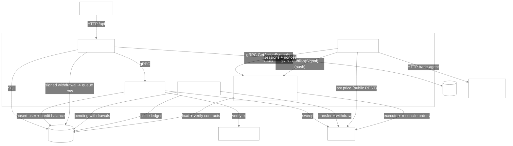

<div align="center">
  
</div>

<p align="center"><b>Automated crypto trading: your wallet, your funds, your rules.</b></p>

<div align="center">
  
  
  
  
  
  
  
  
  
  
  
  
</div>

<br />

CoinBot turns trading signals into KuCoin orders automatically.

## Architecture



| Process          | Role                                                                                                                                                                                                                                                                                                                                | Docs                                       |
| ---------------- | ----------------------------------------------------------------------------------------------------------------------------------------------------------------------------------------------------------------------------------------------------------------------------------------------------------------------------------- | ------------------------------------------ |
| `api_gateway`    | HTTP API — auth, contract signing, deposit intake, and signed withdrawal intake                                                                                                                                                                                                                                                      | [README](process/api_gateway/README.md)    |
| `deposit-worker` | gRPC ticket + background deposit sweeper                                                                                                                                                                                                                                                                                            | [README](process/deposit-worker/README.md) |
| `withdraw-worker`| Executes signed USDT-ERC20 withdrawals: re-verifies the stored intent, moves `MarginV2 -> Main`, calls KuCoin with `remark` idempotency, reconciles history, and settles the ledger.                                                                                                                                                    | [README](process/withdraw-worker/README.md) |
| `trade-engine`   | Turns `signal-gateway` signals into KuCoin **cross-margin** orders, reconciles them against the exchange, and exits positions on TP/SL when ATR is enabled or on an opposite target-side signal. Also serves the gRPC `EngineService` that `signal-gateway` calls. Sole writer of order rows and contract funds (via its `ledger`). | [README](process/trade-engine/README.md)   |
| `signal-gateway` | Runs 6x/day shortly after each 4h UTC candle close. Pulls active symbols sequentially with a round-robin start, asks the `opencode` trade-agent for a prediction per symbol, validates strict JSON and the entry price against KuCoin, then publishes to `trade-engine` over gRPC.                                                  | [README](process/signal_gateway/README.md) |
| `frontend`       | React SPA                                                                                                                                                                                                                                                                                                                           | [README](react/README.md)                  |

## Local development

Create a `.env` (gitignored) before starting the stack. At minimum it must define:

```sh
POSTGRES_USER=...
POSTGRES_PASSWORD=...        # required; compose fails without it
POSTGRES_DB=...
REDIS_PASSWORD=...           # required; Redis runs with AUTH
REDIS_URL=redis://:<the-same-password>@redis:6379
DATABASE_URL=postgres://<user>:<password>@postgres:5432/<db>
API_GATEWAY_ALLOWED_ORIGIN=http://localhost:5173   # explicit; '*' is rejected
DEPOSIT_KC_KEY=...
DEPOSIT_KC_SECRET=...
DEPOSIT_KC_PASSPHRASE=...
TRADE_ENGINE_KC_KEY=...
TRADE_ENGINE_KC_SECRET=...
TRADE_ENGINE_KC_PASSPHRASE=...
WITHDRAW_KC_KEY=...          # dedicated key: Withdrawal + General only
WITHDRAW_KC_SECRET=...
WITHDRAW_KC_PASSPHRASE=...
```

- `make dev` and `make test` use `docker-compose.dev.yml`, which publishes
  Postgres (`5432`) and Redis (`6379`) on **127.0.0.1 only**, so host tools work
  without exposing the services to the LAN.
- `make prod` uses `docker-compose.yml` alone and publishes **no** Postgres or
  Redis ports; only containers on `app-network` can reach them. Redis requires
  `AUTH` (`REDIS_PASSWORD`), and the API gateway receives `REDIS_URL` from the
  compose environment.
- Use URL-safe password characters (e.g. hex/base64url) for `POSTGRES_PASSWORD`,
  or percent-encode them in `DATABASE_URL`.

## Production security checklist

- Terminate TLS at your reverse proxy/load balancer and enable HSTS there. The
  bundled nginx serves plain HTTP and sets `X-Content-Type-Options`,
  `X-Frame-Options`, `Referrer-Policy`, and `Permissions-Policy`; it forwards
  `X-Forwarded-For`/`X-Forwarded-Proto`.
- Set `API_GATEWAY_ALLOWED_ORIGIN` to the exact frontend origin. Wildcards are
  rejected at startup.
- Postgres and Redis publish **no** host ports in production. Set strong,
  unique `POSTGRES_PASSWORD`/`REDIS_PASSWORD` (Redis runs with `AUTH`).
- Use a dedicated KuCoin key per service. `WITHDRAW_KC_*` must have only
  **Withdrawal + General** permissions and should have KuCoin IP and
  withdrawal-address allowlists enabled. Keep secrets out of git and `.env`
  in production; `.env.ci.example` contains CI-only placeholders.
- Set `GRPC_AUTH_TOKEN`; internal deposit and trading gRPC calls reject requests
  without it.
- The opencode AI sandbox runs only on `ai-network`, has no route to Postgres,
  Redis, the API gateway, deposit-worker, or trade-engine, and requires
  `OPENCODE_SERVER_PASSWORD`.
- Deposit verification uses `ETH_RPC_URLS` (comma-separated providers) and
  `ETH_CONFIRMATIONS` (default `12`). Deposits are credited to the owner recorded
  at intake, after asserting the sender matches.
- The withdrawal worker pauses new withdrawals when user liabilities exceed the
  platform's free USDT, and records are still reconciled/expired during a pause.

## CI

On every push, the `changes` job detects which services changed. Tests always run; production images are built and pushed **only for changed services** on `main`:

| Changed paths                                                                                                  | Image rebuilt            |
| -------------------------------------------------------------------------------------------------------------- | ------------------------ |
| `process/api_gateway/**`                                                                                       | `coinbot-api_gateway`    |
| `process/deposit-worker/**`                                                                                    | `coinbot-worker`         |
| `process/withdraw-worker/**`                                                                                   | `coinbot-withdraw-worker`|
| `process/trade-engine/**`                                                                                      | `coinbot-trade_engine`   |
| `process/signal_gateway/**`                                                                                    | `coinbot-signal-gateway` |
| `process/opencode/**`                                                                                          | `coinbot-opencode`       |
| `react/**`                                                                                                     | `coinbot-frontend`       |
| `lib/share/**`, `process/proto/**`, `process/migrations/**`, `Cargo.toml`, `Cargo.lock`, `rust-toolchain.toml` | all Rust images          |

Images are pushed to GHCR as `:latest` and `:<commit-sha>`, with per-image `type=gha` build-layer caching. To force a full rebuild, run **Full-Stack CI → Run workflow** with `build_all` enabled.
