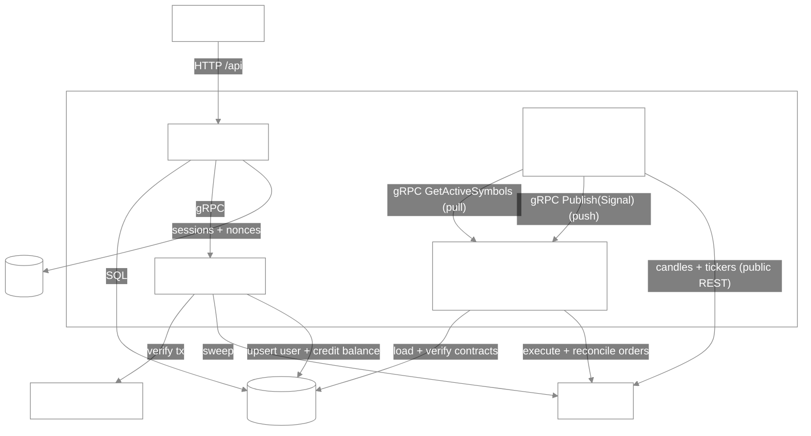

<div align="center">
  
</div>

<p align="center"><b>Trade on autopilot — your wallet, your funds, your rules.</b></p>

<div align="center">
  
  
  
  
  
  
  
  
  
  
  
  
  
</div>

<br />

Math does the watching. Our statistical models read the market around the clock, surface the trades worth taking, and fire them straight to KuCoin before the crowd even blinks.

## Processes



| Process          | Role                                                                                                                                                                                                                                                                                                                        | Docs                                       |
| ---------------- | --------------------------------------------------------------------------------------------------------------------------------------------------------------------------------------------------------------------------------------------------------------------------------------------------------------------------- | ------------------------------------------ |
| `api_gateway`    | HTTP API — auth, contract signing, deposit intake                                                                                                                                                                                                                                                                           | [README](process/api_gateway/README.md)    |
| `deposit-worker` | gRPC ticket + background deposit sweeper                                                                                                                                                                                                                                                                                    | [README](process/deposit-worker/README.md) |
| `trade-engine`   | Turns analyzer signals into KuCoin **cross-margin** orders, reconciles them against the exchange, and exits positions on an opposite target-side signal. Also serves the gRPC `EngineService` that `analyzer` calls. Sole writer of order rows and contract funds (via its `ledger`).       | [README](process/trade-engine/README.md)   |
| `analyzer`       | **[ Unvalidated ]** RSI momentum strategy (Rust): long above RSI 60, short/exit below RSI 50 on 4hour candles by default. Has a deterministic core, an offline backtest harness, and a live path that pushes target-side signals to `trade-engine` over gRPC.                                      | [README](process/analyzer/README.md)       |
| `frontend`       | React SPA                                                                                                                                                                                                                                                                                                                   | [README](react/README.md)                  |

Shared infrastructure: **PostgreSQL** (`users`, `deposits`, `contracts`, `trade_orders`). **Redis** holds gateway sessions (DB 0) and login nonces (DB 1).

### Signal path

`trade-engine` receives signals from `analyzer` over gRPC (`process/proto/analyzer.proto`). The analyzer pulls `GetActiveSymbols` every 30 s and pushes each signal with `Publish`, which the engine answers with an `Ack`. The link is configured with `GRPC_ADDR` on the engine (the bind address) and `GRPC_TRADE_ENGINE_ENDPOINT` on the analyzer (the engine URL).

Each signal gets exactly one publish attempt; nothing is resent after a restart. The engine deduplicates on `signal_id`. See the [analyzer README](process/analyzer/README.md) for the full live design.

## Repository layout

- `process/`: runtime services (`api_gateway`, `deposit-worker`, `trade-engine`, `analyzer`) plus `migrations/` (SQL, applied in order) and `proto/` (gRPC contracts, including `analyzer.proto` for the engine/analyzer link).
- `lib/share/`: shared Rust crate (config, DB models, Redis, RPC helpers).
- `react/`: frontend SPA.
- `docs/`, `scripts/`: project docs, demo seed data, and API smoke tests.

## Quick start

```bash
make dev     # Postgres + Redis + API + worker + trade-engine + analyzer + frontend
make trade   # trade-engine + analyzer live (starts Postgres + Redis)
make test    # Rust tests
make ci      # full pipeline: fmt-fix, clippy, test, analyzer tests, frontend lint-fix, frontend tests, build
```
