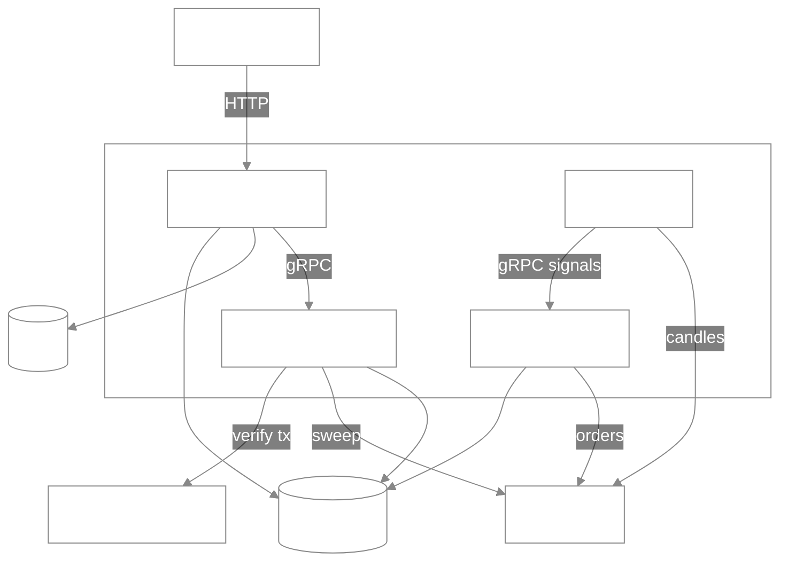

<div align="center">
  
</div>

<p align="center"><b>Automated crypto trading: your wallet, your funds, your rules.</b></p>

<div align="center">
  
  
  
  
  
  
  
  
</div>

<br />

CoinBot turns trading signals into KuCoin orders automatically. **Status: experimental. No strategy has been validated as profitable.**

## Architecture



| Service | Role | Docs |
|---|---|---|
| `api_gateway` | HTTP API: auth, contracts, deposits | [README](process/api_gateway/README.md) |
| `deposit-worker` | Verifies and sweeps deposits | [README](process/deposit-worker/README.md) |
| `trade-engine` | Turns signals into KuCoin cross-margin orders and manages TP/SL exits | [README](process/trade-engine/README.md) |
| `analyzer` | RSI momentum signal generator (unvalidated) | [README](process/analyzer/README.md) |
| `frontend` | React SPA | [README](react/README.md) |

**Signal path:** `analyzer` polls active symbols from `trade-engine` and pushes each signal once over gRPC. The engine deduplicates by `signal_id`. Set `GRPC_ADDR` on the engine and `GRPC_TRADE_ENGINE_ENDPOINT` on the analyzer.

## Layout

- `process/`: services, SQL `migrations/`, and gRPC `proto/`
- `lib/share/`: shared Rust crate
- `react/`: frontend
- `docs/`, `scripts/`: docs, seed data, smoke tests

## Quick start

```bash
make dev     # run everything
make trade   # trade-engine + analyzer only
make test    # Rust tests
make ci      # full pipeline
```
