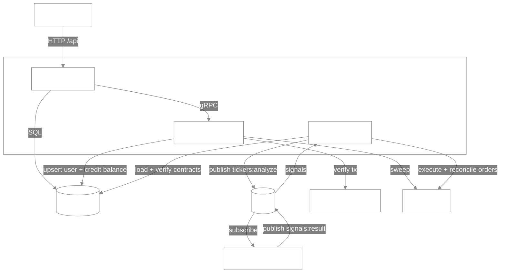

  

<b>Trade on autopilot — your wallet, your funds, your rules.</b>

  
  
  
  
  
  
  
  
  
  
  
  
  

 

Math does the watching. Our statistical models read the market around the clock, surface the trades worth taking, and fire them straight to KuCoin before the crowd even blinks.

## Processes

| Process          | Role                                                                                       | Docs                                       |
| ---------------- | ------------------------------------------------------------------------------------------ | ------------------------------------------ |
| `api_gateway`    | HTTP API — auth, contract signing, deposit intake                                          | [README](process/api_gateway/README.md)    |
| `deposit-worker` | gRPC ticket + background deposit sweeper                                                   | [README](process/deposit-worker/README.md) |
| `trade-engine`   | Publishes tickers, consumes signals, verifies contracts, executes & reconciles spot orders | [README](process/trade-engine/README.md)   |
| `analyzer`       | signal engine (Python)                                                                     | [README](process/analyzer/README.md)       |
| `frontend`       | React SPA                                                                                  | [README](react/README.md)                  |

Shared infrastructure: **PostgreSQL** (`users`, `deposits`, `contracts`, `trade_orders`) and **Redis** (pub/sub channels `tickers:analyze`, `signals:result`).

## Flows

End-to-end flows spanning multiple services. Single-service flows — wallet auth and
contract signing — are detailed in the [api_gateway README](process/api_gateway/README.md).
