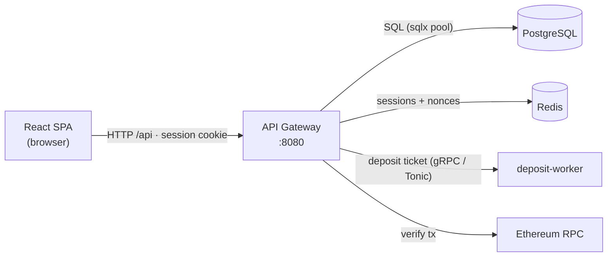
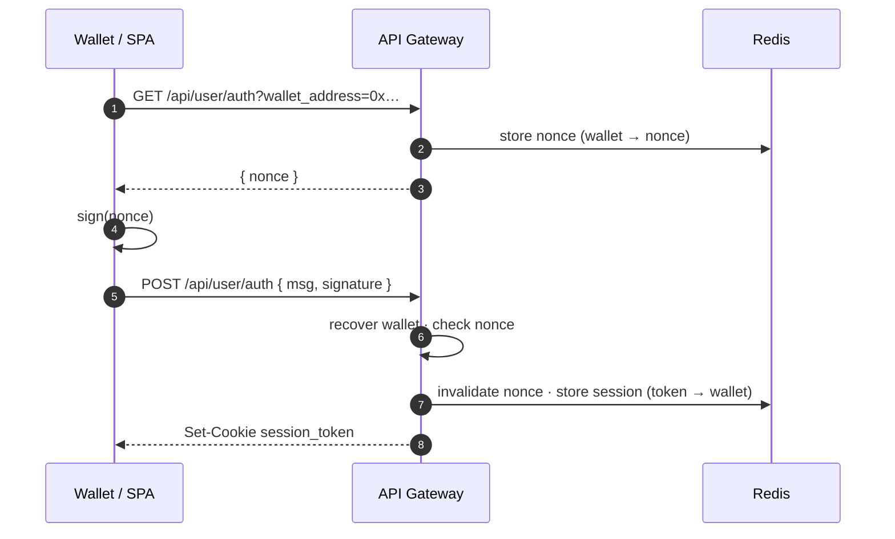

# API Gateway

Actix-Web REST surface for CoinBot.v3. It is the **only HTTP entry point** to the
platform: wallet authentication, contract signing, on-chain deposit intake, and read
endpoints for balances, contracts, and trade orders.

- **Base URL** — `/api` (dev: `http://localhost:8081`)
- **Auth** — an HttpOnly `session_token` cookie issued on login; protected routes
  resolve it to a wallet via Redis. No cookie / expired → `401`.
- **Format** — JSON in and out. `401` unauthenticated · `400` bad input · `500` error.
- **Middleware** — CORS · `NormalizePath` · request logging · rate limiter
  (Governor, ~20 ms/request, burst 100).

## Who talks to the gateway



The browser SPA is the only external client. Downstream it uses PostgreSQL (users,
contracts, deposits), Redis (sessions, nonces), the deposit-worker over gRPC, and
Ethereum RPC to verify on-chain deposits.

## Endpoint index

| Method | Path | Auth | Purpose |
| --- | --- | --- | --- |
| GET | `/api/config` | public | Platform deposit wallet address |
| GET | `/api/stats` | public | Aggregate platform metrics |
| GET | `/api/user/auth` | public | Issue a login nonce for a wallet |
| POST | `/api/user/auth` | public | Verify signature · start a session |
| POST | `/api/user/logout` | cookie | Invalidate the current session |
| POST | `/api/user/verify` | cookie | Check the session is valid |
| GET | `/api/user/stats` | session | The caller's balance stats |
| GET | `/api/contracts/nonce` | session | One-time contract-signing nonce |
| POST | `/api/contracts/sign` | session | Verify + persist a signed contract |
| GET | `/api/contracts/me` | session | The caller's contracts (redacted) |
| GET | `/api/contracts/{id}/orders` | session | The caller's orders for one contract |
| POST | `/api/transactions/deposit` | session | Submit an on-chain USDT deposit |
| GET | `/api/transactions` | session | The caller's deposits |

## Authentication flow



---

## Public

### `GET /api/config`

The deposit address, so the SPA can build USDT transfers.

```json
{ "platform_wallet": "0x…" }
```

### `GET /api/stats`

Aggregate platform metrics for the landing page.

```json
{ "accounts": 3, "active_contracts": 3, "funds_deployed": "8000", "trades_executed": 8 }
```

`funds_deployed` is a decimal string; the counts are integers.

## Auth

### `GET /api/user/auth`

Issue a one-time login nonce for a wallet.

- **Query** — `wallet_address=0x…`
- **200** — `{ "nonce": "…" }`
- **500** — nonce could not be stored

### `POST /api/user/auth`

Recover the wallet from the signature, check it against the stored nonce, invalidate the
nonce, and start a session.

- **Body** — `{ "msg": string, "signature": "0x…" }`
- **Sets** — HttpOnly `session_token` cookie
- **200** · **400** nonce mismatch · **401** bad signature

### `POST /api/user/logout`

Invalidate the current session.

- **200** · **400** no cookie

### `POST /api/user/verify`

Check whether the session is valid — the SPA calls it on load to set `isAuthenticated`.

- **200** valid · **401** expired · **400** no cookie

### `GET /api/user/stats`

The session user's balances.

```json
{ "total": "57000", "free": "50000", "locked": "7000", "realized_pnl": "0" }
```

Decimal strings; `total = free + locked`. `realized_pnl` is a placeholder until PnL
tracking exists. A session with no user row returns zeros.

## Contracts

### `GET /api/contracts/nonce`

A one-time signing nonce bound to the session wallet.

- **200** — `{ "nonce": "…" }`

### `POST /api/contracts/sign`

Validate the session, message nonce, signature (recovered wallet = session wallet),
settings, user, and funds; then lock `init_fund` and insert the contract.

- **Body** — `{ "nonce": string, "message": string, "signature": "0x…" }`
- **`message`** — JSON: `{ "nonce": "…", "settings": { "Ticker", "Amount", "StopLoss", "TakeProfit" } }`
- **200** — `{ "message": "Contract signed" }`
- **400** — malformed message · nonce mismatch · nonce not issued to this wallet · bad settings · unknown user · insufficient funds
- **401** — no session · wallet mismatch · bad signature
- **409** — nonce already used

### `GET /api/contracts/me`

The user's contracts, newest first, signing material omitted.

```json
[ { "id": "…", "ticker": "BTC/USDT", "status": "active",
    "init_fund": "5000", "available_fund": "5000", "total_traded_fund": "7476",
    "sl_pct": 2.0, "tp_pct": 5.0,
    "created_at": "2026-10-07T21:43:40Z", "updated_at": "2026-10-07T21:43:40Z" } ]
```

### `GET /api/contracts/{id}/orders`

The user's trade orders for one contract, newest first. Scoped by **both** user and
contract — a foreign id yields `[]` (no IDOR).

```json
[ { "id": "…", "contract_id": "…", "ticker": "BTC/USDT", "side": "buy",
    "action": "open", "status": "filled", "requested_qty": "0.0600",
    "filled_qty": "0.0600", "fill_price": "82600", "fee": "1.20", "funds": "4956",
    "created_at": "…", "updated_at": "…" } ]
```

## Transactions

### `POST /api/transactions/deposit`

Verify an on-chain USDT deposit and request a deposit ticket.

- **Body** — `{ "tx_hash": "0x…" }`
- **Checks** — sender = session wallet · target = USDT contract · recipient = platform wallet
- **200** — `{ "ticket_id", "timestamp", "accepted" }`
- **400** — unknown/failed tx · non-USDT · malformed transfer · wrong recipient
- **401** no session · **403** sender ≠ session wallet · **500**

### `GET /api/transactions`

The user's deposits, newest first.

- **200** array · **401** · **500**

---

## Layout

```
src/
  main.rs        server bootstrap (state, CORS, rate limit, routes)
  routes.rs      /api route tree
  constants.rs   platform wallet / USDT address literals
  state.rs       shared state (db pool, caches, gRPC channel)
  auth/
    cache.rs     Redis session + nonce caches
    session.rs   authenticate() — resolve the session cookie to a wallet
  handlers/
    auth.rs      challenge, login, logout, verify
    config.rs    GET /api/config
    contracts.rs nonce, sign, me, {id}/orders
    transaction.rs deposit, list
    stats.rs     /api/stats, /api/user/stats
  models/        request/response DTOs
  tests/         route/integration tests
```

Session cookies are `HttpOnly`, `SameSite=Strict`, and `Secure` in release builds; the
Redis session TTL matches the 2h cookie.
