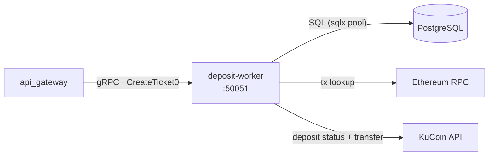
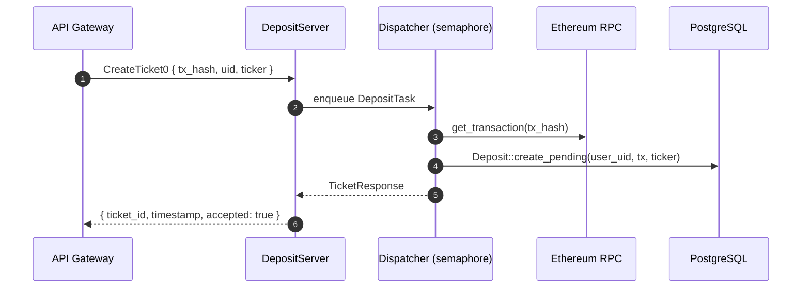

# Deposit Worker

Rust process that ingests on-chain USDT deposits. It exposes a **gRPC** service (called
by the API gateway) that records a *pending* deposit and returns a ticket, and runs a
**background sweeper** that confirms those deposits and credits the user's balance.

- **gRPC** — `wallet.DepositService` on `GRPC_ADDR` (dev: `0.0.0.0:50051`) + a
  tonic-health service.
- **Concurrency** — incoming tickets go through a bounded channel and a semaphore
  (`N_WORKERS`, default 2).
- **Storage** — PostgreSQL (`deposits`, `users`).

## Who talks to the worker, and what it talks to



- **Inbound:** the API gateway calls `CreateTicket0` after it has verified the on-chain
  USDT transaction.
- **Outbound:** Ethereum RPC (`get_transaction`), KuCoin (deposit lookup + internal
  `Main → Trade` transfer), and PostgreSQL.

## gRPC interface

`process/proto/wallet.proto`:

```proto
service DepositService {
  rpc CreateTicket0(TicketRequest) returns (TicketResponse);
}

message TicketRequest  { string tx_hash = 1; string uid = 2; string ticker = 5; }
message TicketResponse { string ticket_id = 1; string timestamp = 2; bool accepted = 3; }
```

`CreateTicket0` enqueues the request and waits for the dispatcher's reply:

- `OK` — ticket created (a pending deposit row)
- `INVALID_ARGUMENT` — the tx couldn't be fetched, or the uid is malformed
- `RESOURCE_EXHAUSTED` — the channel is full (retry later)
- `INTERNAL` — the worker dropped / persistence failed

## Ticket pipeline



## Sweeper

`run_deposit_sweeper` loops every **60s** with two passes:

1. **Finalize pending** — for each `pending` deposit:
   1. look up the USDT deposit via a currency+status-filtered history lookup;
   2. if its status is not `Success` → leave it pending;
   3. on success, **finalize the ledger first** (idempotent): `User::upsert(from_address)`
      + `add_balance(amount)` + `Deposit::confirm(...)` in one transaction;
   4. then sweep USDT `Main → Trade` (`sweep_transfer`).
2. **Retry unswept** — confirmed deposits with `transferred_at IS NULL` retry the sweep.

The sweep atomically claims the deposit (sets `transferred_at`), transfers with a
deterministic `clientOid = deposit.id`, and releases the claim on failure so it is retried.
Crediting **before** sweeping means the user is credited exactly once and a failed sweep
can never move funds twice (the funds simply sit in Main until a retry succeeds).

Failures are logged (`DEPOSIT FINALIZED` / `STILL PENDING` / `FINALIZE FAILED` /
`TRANSFER FAILED`).

## Configuration

| Env | Purpose |
| --- | --- |
| `DATABASE_URL` | PostgreSQL connection (migrations run on startup) |
| `GRPC_ADDR` | gRPC bind address, e.g. `0.0.0.0:50051` |
| `N_WORKERS` | max concurrent ticket tasks (default `2`) |
| `DEPOSIT_KC_KEY` / `KC_KEY` | KuCoin API key (prefixed or bare) |
| `DEPOSIT_KC_SECRET` / `KC_SECRET` | KuCoin API secret |
| `DEPOSIT_KC_PASSPHRASE` / `KC_PASSPHRASE` | KuCoin API passphrase |

`ProcessConfig::new("deposit")` prefers the `DEPOSIT_`-prefixed variable and falls back
to the bare name.

## Layout

```
src/
  main.rs            bootstrap: db + migrations, KuCoin client, gRPC server + health
  grpc_handler.rs    DepositServer::create_ticket0 → enqueue + await reply
  task.rs            DepositTask + dispatcher (semaphore) + process_task
  deposit_sweeper.rs 60s loop: confirm pending deposits, credit balances
  lib.rs             module wiring
```
