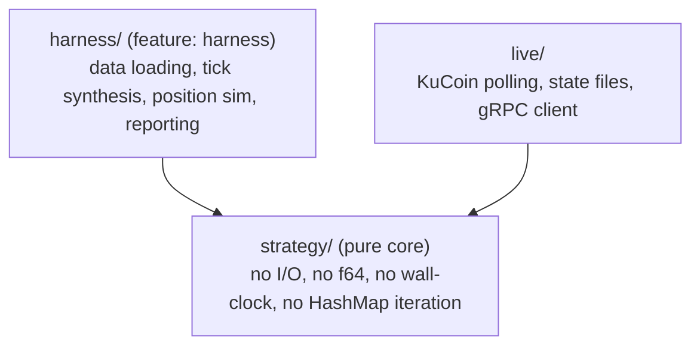
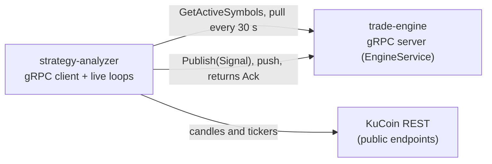
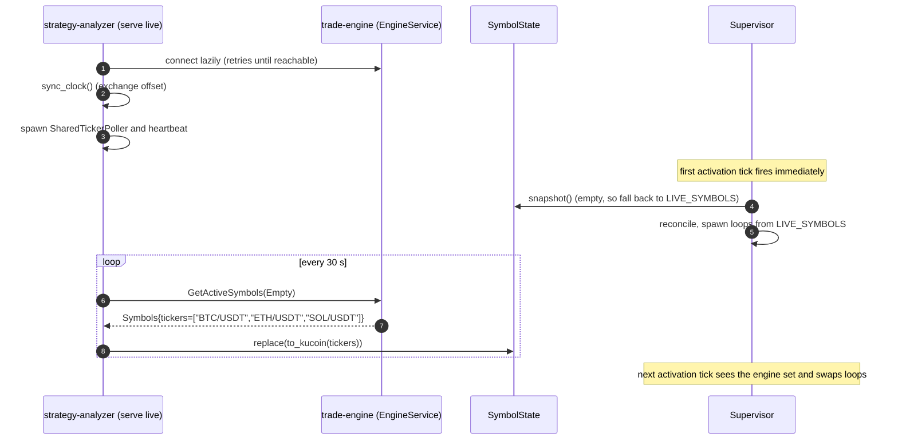
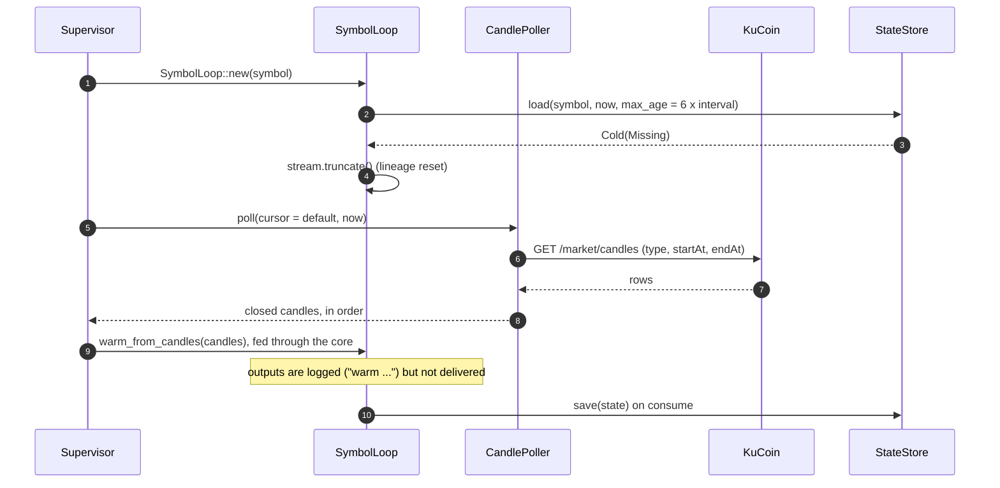
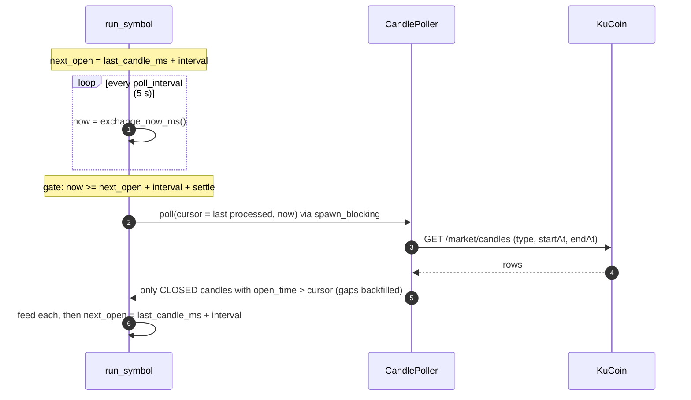
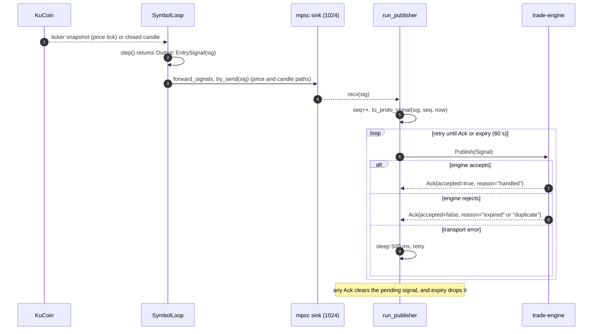
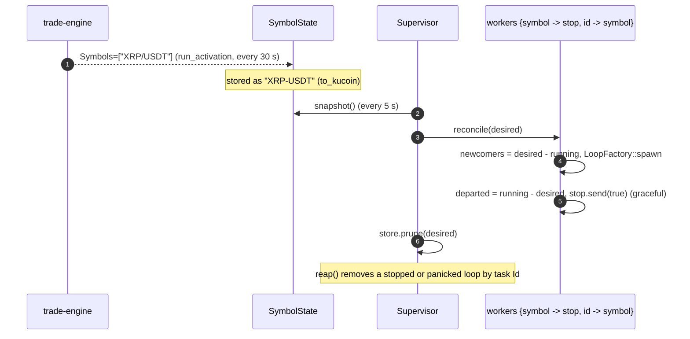
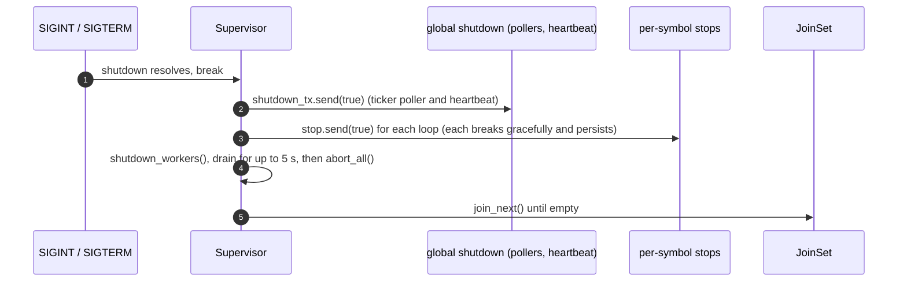

# strategy-analyzer

Supply-and-demand 4H trading strategy, built as three layers:

- a **pure deterministic core** (`src/strategy/`) that turns candles and price ticks into entry signals,
- an **offline backtest and replay harness** (`src/harness/`) that proves the core is deterministic and produces a pre-registered backtest report,
- a **live path** (`src/live/`) that runs the core per symbol against KuCoin and delivers signals to the trade engine over gRPC.

The core and the harness know nothing about the engine. Only the live path talks to it.

| Document            | Path                                                                                                               |
| ------------------- | ------------------------------------------------------------------------------------------------------------------ |
| Strategy spec       | `docs/superpowers/specs/2026-10-17-rust-strategy-analyzer-design.md`                                               |
| Implementation plan | `docs/superpowers/plans/2026-10-17-strategy-analyzer-phase0.md`                                                    |
| Live path code      | `process/strategy-analyzer/src/live/*`, `process/trade-engine/src/grpc_handler.rs`, `process/proto/analyzer.proto` |

## Contents

- [Architecture](#architecture)
- [Building](#building)
- [Backtest CLI](#backtest-cli)
- [Numeric and determinism policy](#numeric-and-determinism-policy)
- [OOS freeze lock and the one-shot guard](#oos-freeze-lock-and-the-one-shot-guard)
- [Live path](#live-path)
- [CI](#ci)
- [Open item to confirm (section 6.3)](#open-item-to-confirm-section-63)

## Architecture

The dependency boundary is one-way: the harness and the live path depend on the core, and the core depends on neither.



- `src/strategy/` is the core: `Decimal`-only math, typed `StrategyError`, no panics, and `#![deny(clippy::float_arithmetic)]` at `strategy/mod.rs`. It knows nothing about where ticks come from, the candle resolution, or the fill model.
- `src/harness/` may use `f64` for reporting statistics, but those values never feed back into the core. The trade ledger stays in `Decimal`.
- `src/bin/backtest.rs` requires the `harness` feature. Its `fetch-data` subcommand is the only place the harness touches the network. `backtest` never fetches.
- `src/live/` is the runtime adapter: HTTP to KuCoin, files for state, and gRPC to the engine. See [Live path](#live-path).

The core exposes:

```rust
step(&StrategyState, Input, &Config) -> Result<(StrategyState, Vec<Output>), StrategyError>
```

It uses **validate-then-commit** semantics. On any error the caller's state is untouched, and a new state is produced only on success.

## Building

```bash
# Pure core only: no clap/ureq/csv compiled, `backtest` bin skipped.
cargo build -p strategy-analyzer --no-default-features

# Core + harness + the `backtest` bin.
cargo build -p strategy-analyzer --all-features

# The purity gate (float/hash-map greps + both builds). Run from the repo root.
make strategy-check
```

## Backtest CLI

### Run it from the crate directory

Fixture paths are resolved relative to the current working directory, so run the CLI from the crate directory:

```bash
cd process/strategy-analyzer
cargo run -p strategy-analyzer --features harness --bin backtest -- \
    backtest --data tests/fixtures/signal_4h.csv
```

Running it from the repo root makes `tests/fixtures/...` resolve against the root and fail. Tests get this for free, because Cargo runs integration tests with the crate directory as the working directory.

**`CARGO_MANIFEST_DIR` policy.** It is a compile-time path. It may be used only to supply a built-in default fixture path (a file shipped inside this crate). It must never rewrite or resolve a user-supplied `--data` path. A user path is a runtime string and belongs to the user's filesystem, so `--data` is opened verbatim, relative to the working directory, like any other CLI file argument.

### Subcommands

The binary is named `backtest`, and it has the subcommands `fetch-data`, `freeze-lock`, `count-signals`, `calibrate` and `backtest`. In the examples below the first word is the binary.

```bash
# Fetch OHLCV and cache it to a CSV, then print its dataset hash. Network only here.
# Refuses any range overlapping the OOS window until the freeze lock exists (--lock).
backtest fetch-data --symbol XRP-USDT --interval 4hour \
    --start-s <unix_seconds> --end-s <unix_seconds> --out data/xrp_4h.csv [--lock lock.json]

# Seal the pre-registered freeze lock (git commit + dataset hashes + boundary + constants).
backtest freeze-lock --data XRP-USDT=data/xrp_4h.csv --price-scale XRP-USDT=4 \
    --mode both --out lock.json

# Count-only in-sample sizing run (section 10.4, step 0): per-symbol signal counts and reason counts.
# Refuses any row at or after the in-sample/OOS boundary. No PnL, no trades, no verdict.
backtest count-signals --data XRP-USDT=data/xrp_4h.csv --price-scale XRP-USDT=4

# Validate a 1m series' 4H aggregate against an independently fetched 4H series (offline).
# 1m candles are bucketed by their 4H grid cell (open_time_ms / 4h), so a mid-bucket start
# still aligns. Refuses the run above AGG_TOLERANCE; never silently patches.
backtest calibrate --one-minute data/xrp_1m.csv --fetched-4h data/xrp_4h.csv

# Run the backtest offline against one or more cached datasets.
backtest backtest --data XRP-USDT=data/xrp_4h.csv --data BTC-USDT=data/btc_4h.csv \
    --price-scale XRP-USDT=4 --price-scale BTC-USDT=2 \
    [--policy both|low_first|high_first] [--mode both|fixed_r|structural] \
    [--lock lock.json] [--oos] [--oos-consumed]
```

### Behaviour worth knowing

- **Per-symbol flags.** `--data SYMBOL=PATH` and `--price-scale SYMBOL=DP` are repeatable. Every symbol needs an explicit price scale. There is no silent default: a missing scale is an error, and neither the symbol set nor the scale is hard-coded.
- **Both by default.** `--policy both` and `--mode both` (the defaults) run both path policies and both target modes side by side.
- **`fetch-data`.** It is throttled, retries with exponential backoff on rate limits, and writes a provenance sidecar (`<out>.provenance.json`: symbol, interval, range, row count, dataset hash) next to the cache. A malformed exchange timestamp is an error and is never silently coerced to `0`.
- **Price increment is core instance data, not a CLI flag.** `Config::price_increment` (the symbol's actual price step, for example `0.0005`) is set per symbol when the core is embedded. The `backtest` and `count-signals` commands do not expose a `--price-increment`, so those runs use dp `--price-scale` rounding. The live path fills the increment from `/api/v2/symbols` `priceIncrement`. A dedicated flag is a small follow-up if the harness needs it.
- **Resolution.** `backtest` and `count-signals` are 4H-synthesis-only. There is no `--resolution` flag, because the cross-resolution comparison in spec section 8.1 is not exposed on the CLI. The `OneMinuteExpansion` tick source exists in `harness::tick_source`, and 1m data is used by `calibrate`. Wiring 1m into the headline backtest is deferred, because the diagnostics would need to drop back to 4H synthesis to stay within budget (spec section 10.4).

## Numeric and determinism policy

- **No floats in the core.** CI runs a `syn`-based token-level purity test over `src/strategy/` that fails on any `f32` or `f64` token. Fast greps (comment-stripped) are kept only as pre-filters for `f32|f64` and `HashMap|HashSet`. The token test catches a real `f64` on a line that also carries a trailing comment, while an `f64` mentioned only in a comment or a string literal is not flagged. Use `BTreeMap` or `Vec`, because randomized iteration order is hidden nondeterminism.
- **One rounding helper.** `decimal::round_price(value, price_scale)` rounds half-up (`rust_decimal` defaults to half-even, so half-up is requested explicitly). The price scale is per symbol (ideally the exchange tick size) and is applied only to levels that appear in signals.
- **Price increment snapping.** When a symbol's actual `price_increment` is configured (for example KuCoin `0.0005`, a step-5 grid that a dp scale cannot express), the core snaps stop, take-profit and reference levels to it with `decimal::snap_to_increment`. The stop snaps away from entry and the take-profit snaps toward entry, so published prices are valid exchange multiples. With no increment it uses dp `round_price`.
- **Ratios are compared unrounded**, at working scale. They are rounded (toward zero, 4 dp) only when serialized or reported. This avoids `2.99996` rounding up to pass a `3.0` floor.
- **Self-consistent payload.** Stop, take-profit and ratios derive from the already-rounded trigger and stop, so the serialized fields reconcile exactly.
- **ATR.** Wilder smoothing seeded with the simple mean of the first 14 true ranges. The first candle's true range is `high - low`. `ATR == 0` on a flat series is not an error: it is emitted in-band as a `StateChange` so the stream does not stall.
- **Serialization.** `Decimal` values serialize as fixed-scale strings, never JSON numbers. Timestamps are `i64` UTC milliseconds internally.
- **`config_version`.** A hash of the canonical strategy parameters (per-symbol `price_scale` and `price_increment` instance data are excluded). It feeds the freeze lock.
- **Replay.** There is no RNG. Replaying the same events is byte-identical, and a mid-stream state snapshot that is serialized and resumed produces the same final state.

## OOS freeze lock and the one-shot guard

The offline backtest bar is pre-registered. The lock is a canonical JSON document, not a bare hash. It includes the git commit, the per-symbol dataset hashes, the in-sample/OOS boundary timestamp, and the pre-registered constants (minimum executed trades, bootstrap block, resamples and seed, aggregate tolerance, perturbation thresholds, draws and seed). Its identity is the sha256 of that JSON, so changing any of those inputs changes the lock.

- **The boundary binds.** A pre-registered UTC boundary (`lock::OOS_BOUNDARY_MS`) splits in-sample from OOS.
  - `count-signals` refuses any row at or after it.
  - `fetch-data` refuses ranges overlapping it until the lock exists.
  - `backtest` refuses to print a verdict for any dataset whose time range touches the OOS window, unless `--oos` and a matching `--lock` are supplied.
- **Non-OOS runs are labelled `EXPLORATORY`**, so a `Pass` cannot be mistaken for a confirmatory result.
- **OOS names exactly one mode.** `--oos` requires a single explicit `--mode` (`fixed_r` or `structural`) that matches the frozen lock. `--mode both` is refused, because each mode is compared in-sample only. A mode that differs from the locked one is refused by name.
- **OOS is one-shot and append-only.** Every OOS invocation is appended to `<lock>.oos.log`, recording the dataset hashes and verdict, so the first confirmatory run's record is preserved. A second OOS run on the same data is refused unless `--oos-consumed` is passed. An overridden run is stamped NON-CONFIRMATORY and reports the earlier run's verdict. After a failure, further tuning requires fresh data.
- **The regime fails closed.** `verdict()` takes a three-state regime (`Both`, `OneRegimeOnly`, `Unknown`). Anything but `Both` yields `VerdictOutcome::Inconclusive`, never a pass.

## Live path

The live path runs the core **per symbol** and delivers entry signals to the trade engine over **gRPC**. The trade engine is the gRPC server (`EngineService`). The analyzer is the client: it pulls the set of active symbols from the engine, and pushes each signal to the engine as soon as it is emitted.



Delivery is **at-least-once**. The analyzer holds a signal until the engine acknowledges it (or it expires) and retries on transport failure. The engine deduplicates on `signal_id`.

| Process             | Role                                                                                  | Entry point                       |
| ------------------- | ------------------------------------------------------------------------------------- | --------------------------------- |
| `trade-engine`      | gRPC server `EngineService`. Owns the contracts DB and KuCoin client, executes trades | `grpc_handler::EngineServer`      |
| `strategy-analyzer` | gRPC client. Runs the strategy loops and manages warm state and the recorded stream   | `serve live` -> `Supervisor::run` |

The analyzer never binds a port. The engine binds `GRPC_ADDR` (for example `0.0.0.0:50051`), and the analyzer connects to `GRPC_TRADE_ENGINE_ENDPOINT` (for example `http://trade-engine:50051`).

### Live configuration

| Variable                                     | Used by  | Default                          | Meaning                                         |
| -------------------------------------------- | -------- | -------------------------------- | ----------------------------------------------- |
| `GRPC_ADDR`                                  | engine   | none                             | Bind address, for example `0.0.0.0:50051`       |
| `GRPC_TRADE_ENGINE_ENDPOINT`                 | analyzer | `http://127.0.0.1:50051`         | Engine endpoint (scheme required)               |
| `LIVE_SYMBOLS`                               | analyzer | none (required, non-empty)       | Startup fallback symbol list                    |
| `LIVE_CANDLE_INTERVAL`                       | analyzer | `4hour`                          | KuCoin candle interval (`15min`, ...)           |
| `LIVE_STATE_DIR` / `LIVE_STREAM_DIR`         | analyzer | `data/live/state` / `.../stream` | Persistence paths                               |
| `LIVE_CONFIG` / `serve live --config <json>` | analyzer | none                             | `LiveConfig` JSON (`LIVE_*` variables override) |
| `RUST_LOG`                                   | both     | `info`                           | Log filter                                      |

`LiveConfig` defaults:

| Field                        | Default |
| ---------------------------- | ------- |
| `poll_interval_ms`           | 5000    |
| `price_staleness_ms`         | 30000   |
| `candle_settle_ms`           | 5000    |
| `rate_limit_min_interval_ms` | 30      |
| `max_retries`                | 3       |
| `retry_base_ms`              | 250     |
| `retry_max_ms`               | 5000    |
| `jitter_pct`                 | 20      |

Fixed intervals:

| Interval                | Value                          |
| ----------------------- | ------------------------------ |
| Activation diff         | 5 s (`ACTIVATION_TICK`)        |
| `GetActiveSymbols` poll | 30 s                           |
| Clock heartbeat         | 300 s (`CLOCK_REFRESH`)        |
| Signal expiry           | 60 s                           |
| Warm lookback           | 80 candles (`CANDLE_LOOKBACK`) |

### Proto contract

Defined in `process/proto/analyzer.proto`. Both sides compile the same file (the analyzer through its own `build.rs`, the engine through `share`), so the wire format is identical.

```proto
service EngineService {
  rpc GetActiveSymbols(Empty) returns (Symbols);   // activation
  rpc Publish(Signal) returns (Ack);               // delivery
}

message Empty {}
message Symbols { repeated string tickers = 1; }    // engine/DB form: "BTC/USDT"
message Ack { bool accepted = 1; string reason = 2; }

message Signal {
  string ticker = 1;          // engine/DB form: "BTC/USDT"
  string action = 2;          // "BUY" | "SELL"
  double entry_price = 3;
  uint32 schema_version = 4;
  string signal_id = 5;       // engine dedup key
  uint64 seq = 6;             // global monotonic (in-memory today)
  int64  expires_at_ms = 7;   // emission + 60 s
  int64  trigger_time_ms = 8; // touching-tick time
  double sl_price = 9;
  double tp_price = 10;
  string zone_id = 11;
  string reason = 12;
}
```

### Live components

| Component                       | File                   | Responsibility                                                           |
| ------------------------------- | ---------------------- | ------------------------------------------------------------------------ |
| `Supervisor`                    | `live/supervisor.rs`   | Owns the run loop: pollers, per-symbol workers, shutdown                 |
| `LoopFactory`                   | `live/supervisor.rs`   | Clones shared dependencies to start one symbol loop                      |
| `reconcile` / `reap`            | `live/supervisor.rs`   | Membership diff (spawn or stop loops) and task bookkeeping by `Id`       |
| `SymbolLoop`                    | `live/sym_loop.rs`     | One symbol: advances `StrategyState`, records inputs, emits `LiveEvent`s |
| `SharedTickerPoller`            | `live/poller.rs`       | One `allTickers` snapshot per poll, fanned out to all loops              |
| `CandlePoller`                  | `live/poller.rs`       | Fetches a symbol's candles and emits only closed ones, in order          |
| `MarketData` / `UreqMarketData` | `live/poller.rs`       | Blocking HTTP boundary (`ureq`) to KuCoin                                |
| `RateLimiter` / `with_retry`    | `live/poller.rs`       | Global pacer and 429/5xx backoff                                         |
| `StateStore`                    | `live/state_store.rs`  | Per-symbol warm state (atomic writes, single-writer lock)                |
| `RecordedStream`                | `live/sym_loop.rs`     | Append-only journal of accepted inputs (for replay)                      |
| `EngineClient`                  | `live/grpc.rs`         | Generated client plus `active_symbols()` and `publish()`                 |
| `run_publisher`                 | `live/grpc.rs`         | Drains the signal sink, maps each signal, and calls `Publish` with retry |
| `run_activation`                | `live/grpc.rs`         | Polls `GetActiveSymbols` into `SymbolState`                              |
| `SymbolState`                   | `live/symbol_state.rs` | Shared set of engine-active symbols (engine form)                        |
| `to_kucoin` / `to_contract`     | `live/symbol_state.rs` | Symbol-format normalization                                              |

### How it runs

**Supervisor.** `Supervisor::run(shutdown, signal_tx, active_symbols)`:

1. `sync_clock` once to measure the exchange time offset.
2. Start the shared ticker poller and the clock heartbeat. Both watch the global shutdown.
3. Build a `LoopFactory` from the shared dependencies (`strategy_cfg`, `live_cfg`, `store`, `market`, `clock`, `limiter`, `retry`, `ticker_tx`, `signal_tx`).
4. `select!` on three things:
   - **shutdown**: break.
   - **`ACTIVATION_TICK` (5 s)**: read `SymbolState`, `reconcile` (spawn or stop loops), prune state.
   - **`JoinSet::join_next_with_id()`**: `reap` the finished or panicked loop.

**Symbol loop.** Each symbol loop (`run_symbol`) `select!`s on:

- Its own per-symbol `stop` watch: break gracefully (state is already persisted).
- The broadcast ticker snapshot: feed a `Price` tick.
- A `poll_interval` tick (5 s): fetch the next candle when the close gate passes.

### Sequence diagrams

The candle interval in these diagrams comes from `LIVE_CANDLE_INTERVAL`.

#### A. Startup and activation



#### B. Cold warm (per symbol)



#### C. Candle fetch cadence (one closed candle per interval)



#### D. Signal: emit, publish, acknowledge



Engine side of `Publish` (`grpc_handler.rs`):

1. Reject if `expires_at_ms < now`.
2. Deduplicate on `signal_id` (in-memory).
3. Map to the engine's `TradeSignal` (`confidence = 1.0`).
4. Hand off to `signal_handler`, then `trader::execute`.

#### E. Dynamic activation (add or stop symbols)



#### F. Shutdown



### State and persistence

| Store           | Path                              | Config            | Notes                                                                                                                                                                                                  |
| --------------- | --------------------------------- | ----------------- | ------------------------------------------------------------------------------------------------------------------------------------------------------------------------------------------------------ |
| State store     | `data/live/state/<SYMBOL>.json`   | `LIVE_STATE_DIR`  | Current `StrategyState`, written atomically (temp file, fsync, rename, fsync dir). The single-writer lock `analyzer.lock` is removed on clean exit. After a hard kill it is left behind, so delete it. |
| Recorded stream | `data/live/stream/<SYMBOL>.jsonl` | `LIVE_STREAM_DIR` | One accepted input per line. Truncated on a cold start, so replay from empty state reproduces the run.                                                                                                 |

Symbols in paths use the KuCoin form (`BTC-USDT`), because a `/` would break the file path.

### Symbol formats

| Boundary                                                 | Form         | Example    |
| -------------------------------------------------------- | ------------ | ---------- |
| Engine/DB contracts, `GetActiveSymbols`, `Signal.ticker` | `BASE/QUOTE` | `BTC/USDT` |
| Analyzer loops, KuCoin API, state and stream files       | `BASE-QUOTE` | `BTC-USDT` |

`run_activation` applies `to_kucoin` when storing symbols. `to_proto_signal` applies `to_contract` when sending.

### Failure behaviour

| Situation              | Behaviour                                                                                                                                                                                |
| ---------------------- | ---------------------------------------------------------------------------------------------------------------------------------------------------------------------------------------- |
| Engine unreachable     | `connect_lazy` keeps retrying. `run_publisher` retries each `Publish` every 500 ms until ack or expiry. `run_activation` logs and retries. The analyzer keeps running on `LIVE_SYMBOLS`. |
| Candle gap or revision | `CandlePoller` backfills a leading hole and forward-fills an unfillable one. A repeated candle error quarantines the symbol (`CANDLE_ERROR_THRESHOLD`).                                  |
| Stale price            | A tick older than `price_staleness_ms` is not fed. Recovery goes through `Resume`.                                                                                                       |
| Duplicate `Publish`    | The engine deduplicates on `signal_id` (in-memory today).                                                                                                                                |
| Signal lost            | Held pending until ack or the 60 s expiry. A signal not acknowledged within 60 s is dropped.                                                                                             |

### Known limits

- `seq` is in-memory. It resets to 1 per process and is not used for engine dedup.
- Engine dedup is in-process, so it is lost on restart. A durable `signal_id` table is a follow-up.
- Activation cannot tell "not polled yet" from "engine has no symbols", so an empty set falls back to `LIVE_SYMBOLS`.
- No TLS or auth on the gRPC channel, and the engine has no health service.
- Delivery is an immediate push over a synchronous unary `Publish`. There is no streaming and no ack cursor, unlike the earlier `after_seq` design.

## CI

The Rust job runs on a two-leg architecture matrix, `x86_64` (`ubuntu-latest`) and `arm64` (`ubuntu-24.04-arm`), so the cross-platform golden hash (`replay_equivalence`) is compared on both architectures on every run. The golden file `tests/golden/outs.hash` is committed and is never written by the test. A missing golden file fails the leg.

Caveat: `ubuntu-24.04-arm` is a GitHub-hosted arm64 runner, and its availability depends on the account or plan (it may also need enabling for forks or private repositories). If the arm64 runner is unavailable in a given context, that leg must be enabled or replaced with an equivalent arm64 runner. The cross-platform golden-hash check is not meaningful with a single architecture.
