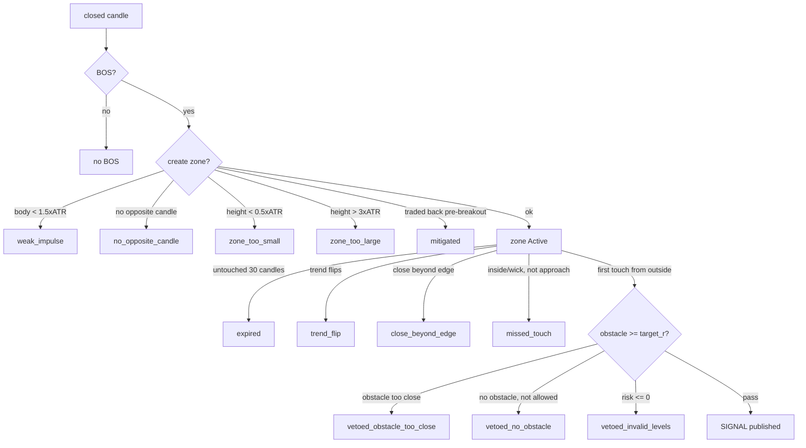
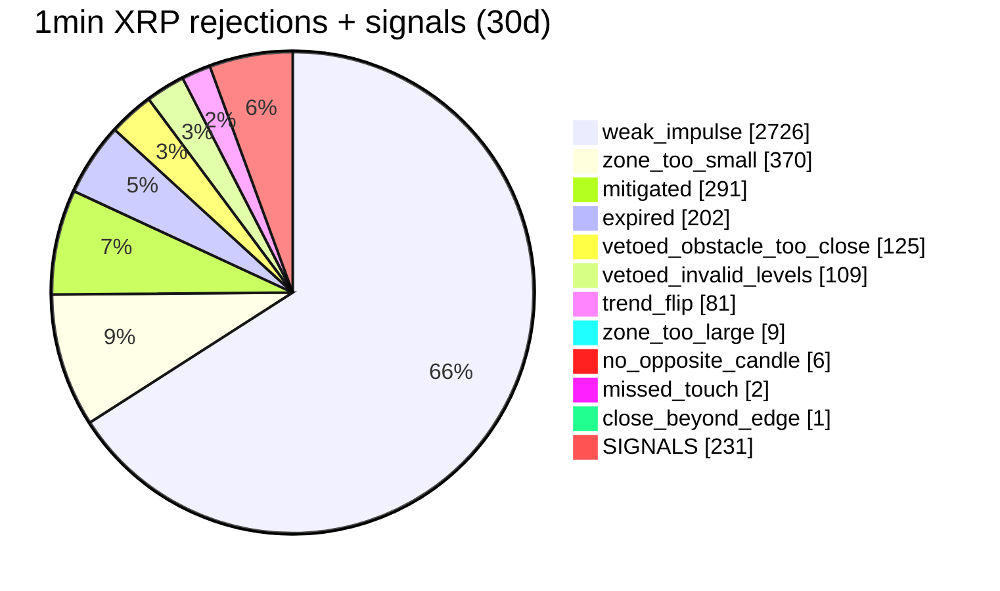

# Strategy Analyzer — Reason & Veto Codes (visual)

Every signal the core emits is the survivor of a chain of filters. When a signal does **not** appear, a **reason code** records where it was rejected. `count-signals` and `backtest` print these as `reason_counts[...]`.

There are two families:
- **Zone-creation rejections** — a BOS happened but no zone was created.
- **Zone-outcome reasons** — a zone *formed*, then ended (consumed / invalidated / expired) or produced a signal.

## Glossary

### A. Zone-creation rejections (no zone created)
| reason | meaning |
|---|---|
| `weak_impulse` | breakout candle **body < 1.5 × ATR** — the move isn't impulsive enough |
| `mitigated` | price **traded back into the zone** between the zone candle and the breakout (before activation) → setup already used |
| `zone_too_small` | zone height **< 0.5 × ATR** (fees/slippage would dominate) |
| `zone_too_large` | zone height **> 3.0 × ATR** (stop too far) |
| `no_opposite_candle` | no bearish (demand) / bullish (supply) candle in the lookback window |
| `atr_zero` | flat series → ATR is 0 (handled in-band; BOS/zones skipped this candle) |
| `no_candles` | not enough candles |

### B. Zone-outcome reasons (a zone formed, then ended)
| reason | meaning |
|---|---|
| `expired` | untouched for `zone_expiry_candles` (default **30**) |
| `trend_flip` | trend reversed → wrong-direction zone invalidated |
| `close_beyond_edge` | a candle closed **beyond the zone's far edge** → invalidated |
| `missed_touch` | first observation was **inside/beyond** the zone (not an approach from outside), or a **candle wick** overlapped it with no observed tick |
| `vetoed_obstacle_too_close` | first touch, but the **next opposing structure was closer than the target** (`target_r`, default 3R) → veto (zone consumed) |
| `vetoed_no_obstacle` | no obstacle and `allow_no_obstacle = false` → veto (zone consumed) |
| `vetoed_invalid_levels` | risk ≤ 0 / invalid levels → veto (zone consumed) |
| `signal_published` | ✅ the successful entry (the signal) |

The three `vetoed_*` codes are the **obstacle / reward-to-risk filter**, applied at the final stage: the touch occurred, but there wasn't enough clear room to the next opposing structure, so the trade was skipped.

## Where each code happens (pipeline)

## Example counts

`XRP-USDT`, **1min**, 2025-12 (30 days), default params, `--policy low_first` — counts only (no PnL). Both path policies agreed.

| metric | 1min (XRP, 30d) | 4H (XRP, ~3y) |
|---|---|---|
| signals | **231** | 34 |
| signals/day/symbol | **~7.7** | ~0.03 |
| mean gap | **~3.1 h** | ~1/month |
| median gap (p50) | ~2.3 h | — |
| p90 gap | ~7.1 h | — |

**How to read it:** `weak_impulse` dominates — the **impulse gate is the main filter**, which is why even 1min only yields ~7.7 signals/day. The `vetoed_*` codes are the **reward-to-risk filter at the touch**; `expired`/`trend_flip`/`close_beyond_edge`/`missed_touch` are the **zone lifecycle** ending a zone before any entry.

**Caveats:** counts only — no PnL, no fills; at low timeframes (e.g. 1min, `ATR(14) ≈ 14 min`) a "3R" target is a few basis points, so many signals are likely cost-dominated. One pair, one window, default (4H-tuned) params. These reasons are what `count-signals`/`backtest` report; the live shadow (`serve live`) logs the same codes.
