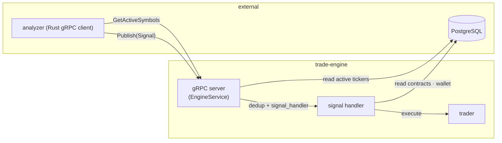
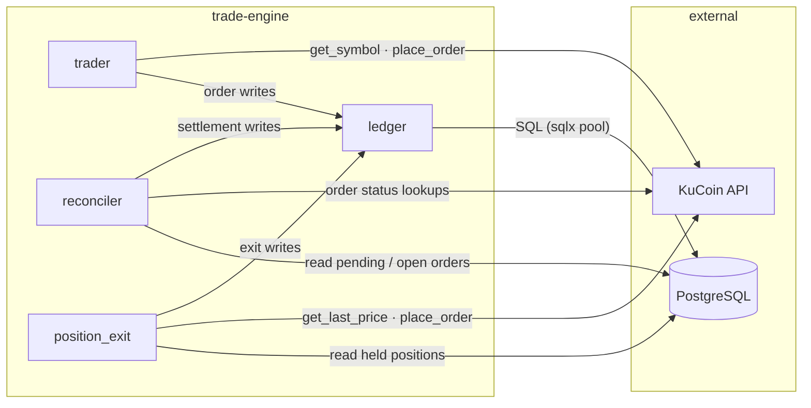
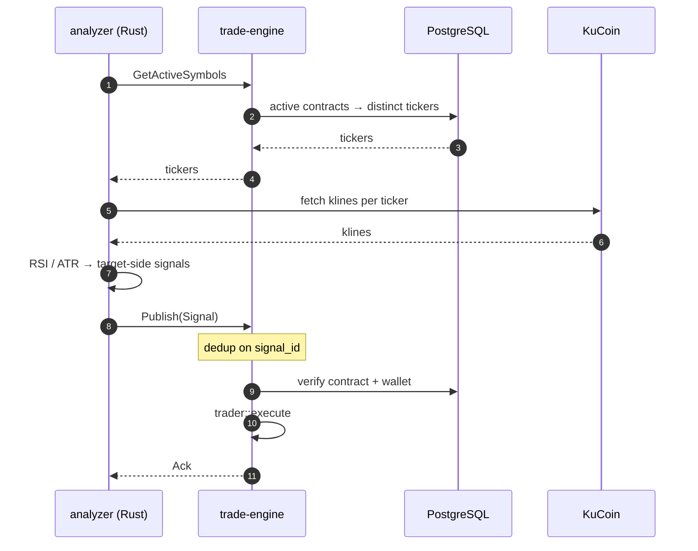
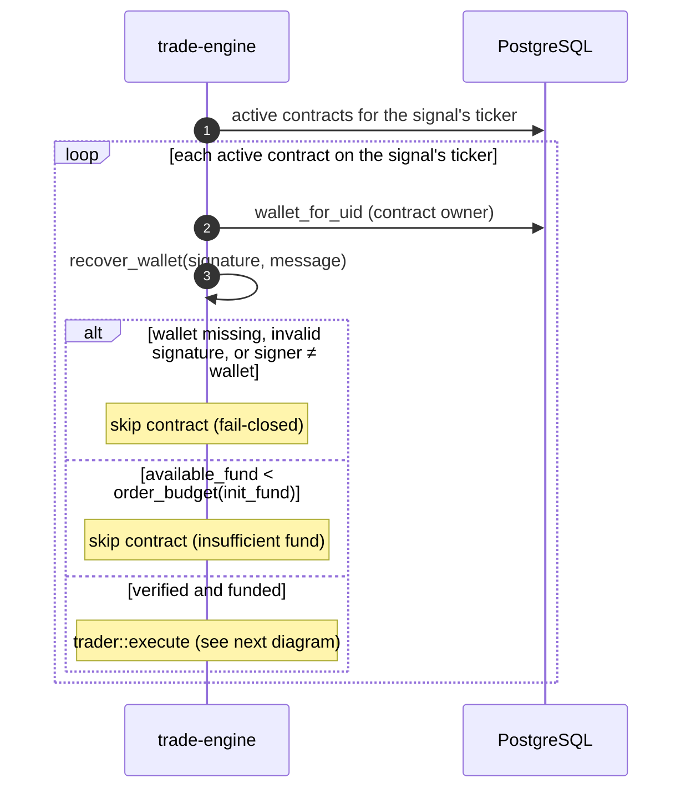
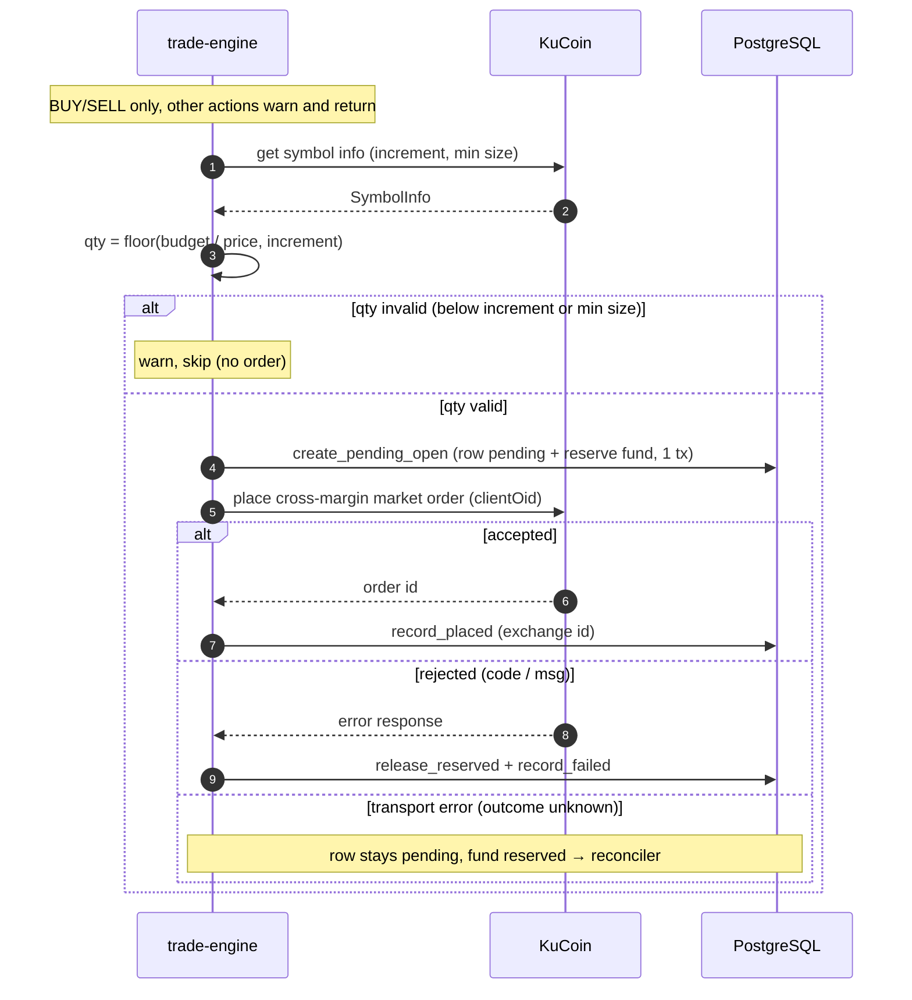
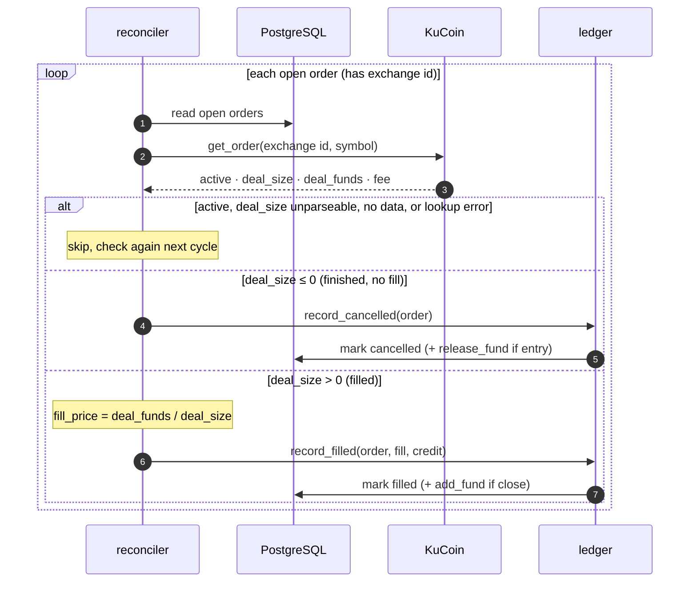
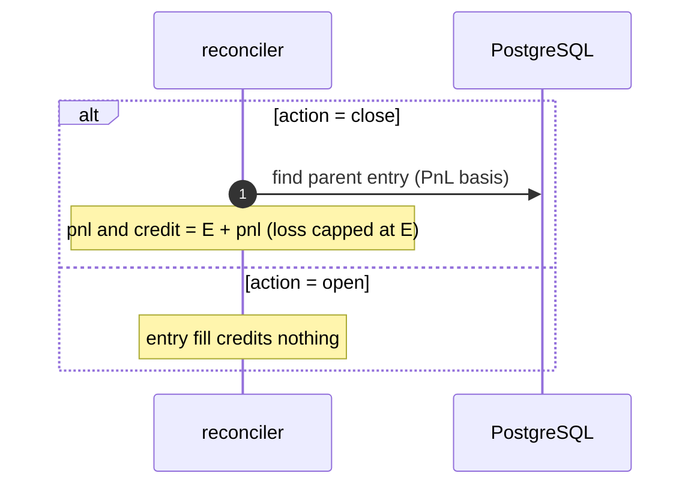

# Trade Engine

Rust process that turns analyzer signals into KuCoin cross-margin orders and keeps the ledger in sync.

- The analyzer computes signals and places no orders. The engine re-verifies every contract before acting.
- **Fail-closed:** a check that cannot pass causes a skip, never a guess.

## Components

Three background tasks, spawned in `src/main.rs`:

| Task            | Entry                 | Purpose                                                                  |
| --------------- | --------------------- | ------------------------------------------------------------------------ |
| gRPC server     | `grpc_handler::serve` | serves `EngineService`; the analyzer pulls symbols and publishes signals |
| Reconciler      | `reconciler::run`     | every 30s, resolves pending orders and settles open orders and funds     |
| Position exit   | `position_exit::run`  | every 12s, exits held positions at TP or SL (backs off on 429)           |

`signals::signal_handler` verifies and executes each published signal; the gRPC server calls it for every `Publish`.

Terms:

- **clientOid**: client order id sent with each order (stored in `trade_orders.comment`). Finds orders whose exchange id was never received.
- **TP / SL**: take-profit and stop-loss prices, from the signal.
- **Order status**: `pending` (no exchange id yet), `open` (accepted by KuCoin). `filled`, `cancelled`, `failed` are final.
- **Fill VWAP** (`fill_price`): `deal_funds / deal_size`.

Modules (`src/`):

- `main.rs`: config, shared state, spawns the three tasks
- `signals.rs`: `signal_handler`
- `grpc_handler.rs`: `EngineService` (active symbols + signal publish)
- `trader/`: signal to order (`mod`, `order`, `sizing`)
- `ledger/`: only writer of order rows and contract funds (`orders`, `funds`)
- `reconciler/`: settlement (`pending`, `settle`, `pnl`, `exchange`)
- `position_exit/`: TP/SL polling and exits (`mod`, `decision`, `price`, `exit`)
- `app_state.rs`: DB pool and KuCoin client
- `app_config.rs`: env config (secrets redacted in Debug)
- `symbol.rs`: `margin_symbol()`

## Connections

Each arrow is a call in the source. Only `ledger` writes to PostgreSQL; other components only read it.

Signal path:

Order path:

Exact calls behind the ledger edges:

- `order writes` (trader): `create_pending_open`, `record_placed`, `release_reserved`, `record_failed`
- `settlement writes` (reconciler): `record_placed`, `record_failed`, `release_reserved`, `record_cancelled`, `record_filled`
- `exit writes` (position_exit): `reserve_exit`, `record_failed`, `record_placed`
- `order status lookups` (reconciler): `get_order`, `get_order_by_client_oid`

## gRPC interface

`EngineService` is defined in `process/proto/analyzer.proto`; the analyzer is the client.

| RPC                | Direction         | Payload                                                                                                              |
| ------------------ | ----------------- | -------------------------------------------------------------------------------------------------------------------- |
| `GetActiveSymbols` | analyzer → engine | returns the distinct tickers of active contracts                                                                     |
| `Publish`          | analyzer → engine | `Signal { ticker, action, entry_price, signal_id, seq, expires_at_ms, trigger_time_ms, sl_price, tp_price, reason }` |

- `action` is uppercased; anything other than `BUY` or `SELL` is logged and ignored.
- `Publish` deduplicates on `signal_id` for the process lifetime and returns an `Ack`.
- `sl_price`/`tp_price` of zero mean "no protective level".
- `BUY`/`SELL` are target-side: the engine closes an opposite held entry before opening the target side.

## Signal → execution

The analyzer pulls active symbols, then publishes target-side signals over gRPC:

Each signal is checked against every active contract on its ticker. Failing contracts are skipped:

`order_budget(init_fund)` is half of `init_fund`. Passing contracts go to `trader::execute`:

## Reconciliation (`reconciler`)

`reconciler::run` runs every 30 seconds: the pending pass, then the open pass. All DB writes go through `ledger`.

### Pending pass

Orders with status `pending` and no exchange id are looked up with `get_order_by_client_oid`:

- **Found:** `ledger::record_placed` stores the exchange id → `open`. Also repairs a `record_placed` that failed after KuCoin accepted.
- **404 and older than 5 minutes:** `ledger::record_failed` → `failed` (`not placed (reconciled)`). An entry then gets `ledger::release_reserved`. Failure is written first, so a release error cannot leave the row `pending`. Exits reserved no fund.
- **Other lookup error:** logged. Fails only once older than 30 minutes (this cap does not apply to 404s).

### Open pass

Orders with an exchange id are fetched with `get_order` and classified:

A filled order's credit depends on its action, and is computed before `record_filled`:

Settlement rules:

- **Cancel** (`deal_size` ≤ 0): `ledger::record_cancelled` → `cancelled`. Releases the fund only for an `open` entry.
- **Fill** (`deal_size` > 0): `ledger::record_filled` → `filled`. A close also gets PnL and fund credit (see [Fund accounting](#fund-accounting)).
- **Errors:** failed `get_order` or missing data is rechecked next cycle. Malformed `deal_funds` or `fee` aborts and retries. Malformed `deal_size` counts as still working.
- **Idempotent:** `mark_filled` and `mark_cancelled` update only `open` rows. A repeat settle fails its transaction and is logged.
- **Caveat:** a partly filled, then cancelled order settles as a full fill at the partial `deal_size`.

## Position exit (TP/SL and reversals)

The TP/SL loop below is separate from signal-driven reversals: `trader::execute` closes an
opposite held entry through `position_exit::close_at_market` before opening the target side.

**Operator note.** A pre-existing hedged position (both target and opposite legs held) is
recovered by the first target-side signal: the engine closes the opposite leg and does not
open another target position. Duplicate-close prevention is atomic.

Every 12 seconds, `position_exit::run` performs one sweep:

1. **Load held positions:** `action = 'open'` and `status = 'filled'`, with no live exit. Live = a close row that is `open` or `filled`, or `pending` under 5 minutes old. Failed or cancelled exits do not block a retry.
2. **Fetch prices:** `GET /api/v1/market/orderbook/level1`, once per distinct held symbol. Any failure aborts the sweep.
3. **Decide:** compare last price with stored `tp_price` / `sl_price`. Skip positions missing either.
   - entry `buy`: exit when `last ≥ tp` (TP) or `last ≤ sl` (SL)
   - entry `sell`: exit when `last ≤ tp` (TP) or `last ≥ sl` (SL)

   TP is checked first. Other sides never exit.
4. **Exit** (`exit_position`):
   - **Reserve:** `ledger::reserve_exit` inserts a `pending` close row (`parent_order_id` set, new UUID clientOid). Moves no fund. No row returned → live exit exists, skip.
   - **Place:** opposite-side market order via `place_order`.
   - **Transport error:** row stays `pending`; reconciler resolves by clientOid.
   - **Rejected:** `ledger::record_failed` stores code and message. Eligible again next sweep.
   - **Accepted:** `ledger::record_placed` stores the exchange id.

**Backoff.** On `429 Too Many Requests` from the price request, the sweep stops and places no exits. Waits: 30, 60, 120, 240, then 300 seconds. A successful sweep resets the wait to 12 seconds. Other errors neither reset nor extend it. A 429 on `place_order` is an ordinary exit failure.

**One live exit per position.** Migration `process/migrations/20261016_order_reconcile_and_deposit_sweep.sql` creates partial unique index `idx_trade_orders_active_close` (at most one `pending` or `open` close row per entry). `reserve_exit` uses `ON CONFLICT DO NOTHING`; a conflict returns no row and the position is skipped. Blocks duplicate exits across engine instances. The reservation also requires the parent entry to still be `filled` and no close in `pending`/`open`/`filled` to exist, so a position settling between `held_entries` and `reserve_exit` cannot be closed twice.

## Fund accounting

Per contract:

- `init_fund`: the allocation. Fixed.
- `available_fund`: usable for new entries.
- `total_traded_fund`: entry funds reserved, minus releases. Closing does not reduce it.

`trade_fund` = entry price × quantity. An entry's `funds` column holds the same value, called `E`.

| Event                                 | Effect                                                                 |
| ------------------------------------- | ---------------------------------------------------------------------- |
| entry reserved (pending row created)  | `available_fund −= trade_fund`, `total_traded_fund += trade_fund`      |
| entry fill                            | no credit; sets `fill_price`                                           |
| entry cancelled (no fill)             | `available_fund += funds`, `total_traded_fund −= funds`                |
| entry rejected or never placed        | `available_fund += funds`, `total_traded_fund −= funds`                |
| exit (close) fill                     | `available_fund += E + pnl` (PnL net of both fees, loss capped at `E`) |
| exit rejected, failed, or cancelled   | no fund change (an exit reserves no fund)                              |

- The entry reservation happens in `ledger::create_pending_open`, before the exchange call.
- One closed round trip ends with `available_fund = init_fund + pnl`, when no other order holds reserved funds.

**Realized PnL of a close** (`src/reconciler/pnl.rs`, used by `settle.rs`):

- Entry basis `B` = `filled_qty × fill_price`. No recorded fill → entry's committed fund, with a warning.
- Exit proceeds `C` = close `deal_funds`.
- Fees are quote-currency. Base-asset fees are converted at the fill price; quote or currency-less fees are used as is.
- Long (`buy`): `PnL = C − B − fees`. Short (`sell`): `PnL = B − C − fees`.
- Loss capped at `E`, so `PnL ≥ −E`.
- Credit `E + PnL` goes to `available_fund` in the same transaction that marks the close `filled`. Entry fills never credit.
