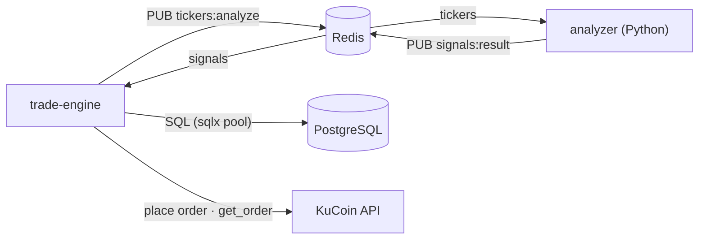
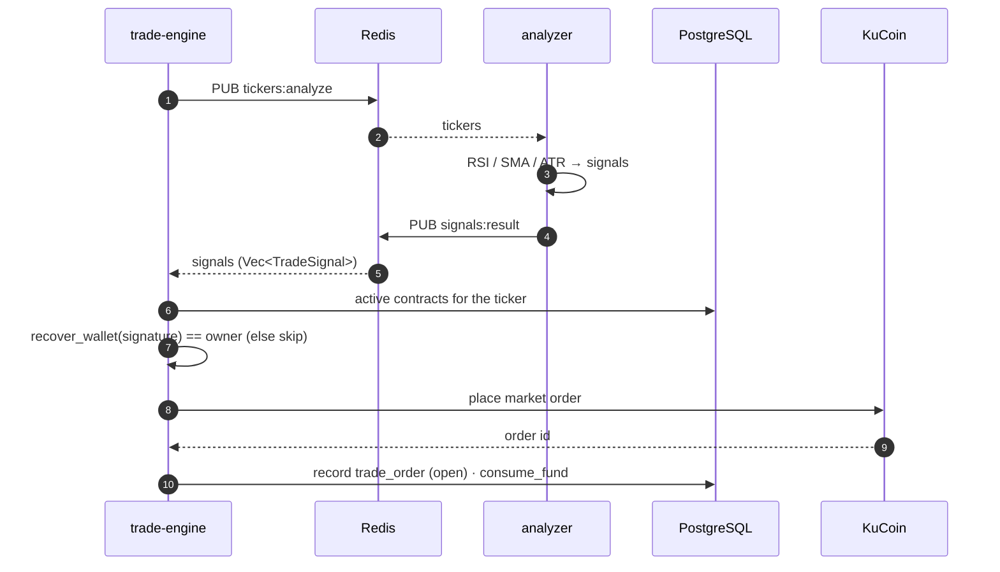
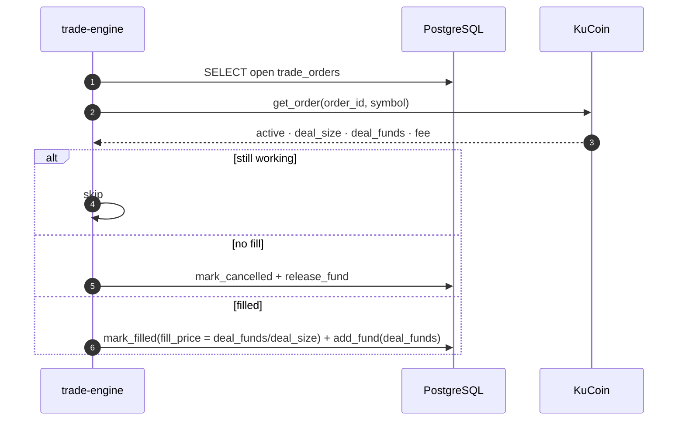

# Trade Engine

Rust process that turns **analyzer signals** into real KuCoin spot orders and keeps the
ledger in sync. It is the bridge between the Python analyzer (which only computes
signals) and the exchange, and it **re-verifies every contract before acting**
(fail-closed).

Three concurrent tasks:

- **Signal generator** — publishes the active tickers to Redis, once every 24h.
- **Signal subscriber** — consumes `signals:result` and executes per contract.
- **Contract sweeper** — every 30s, reconciles open orders and settles contract funds.

## Connections



## Signal → execution



For each active contract on the signal's ticker:

1. Resolve the owner's wallet (`wallet_for_uid`).
2. **Verify the stored signature** — `recover_wallet(signature, message)` must equal the
   wallet, otherwise the contract is skipped (`fail-closed`).
3. Require `available_fund ≥ init_fund / 4`.
4. `trader::execute` — size `qty = available_fund / price` (floored to 4 dp), claim the
   order slot (unique `comment = contract_id`), place a KuCoin **spot market** order,
   then `consume_fund` and `mark_placed`.

## Reconciliation (sweeper)

Every **30s**, `sync_contract_status` loads all `open` orders and reconciles each:



- **cancel** (finished, no fill) → `release_fund` returns the reserved funds to the
  contract.
- **fill** → `fill_price = deal_funds / deal_size` (the average execution price, VWAP),
  and `add_fund(deal_funds)` credits the proceeds back to the contract.
- Failures at each step are logged; the settle only logs "filled @ price" after a
  successful commit.

## Fund accounting

Per contract, `init_fund` is the allocation; `available_fund` and `total_traded_fund`
move as orders run:

| Event | Effect |
| --- | --- |
| open (on placement) | `available_fund −= trade_fund`, `total_traded_fund += trade_fund` |
| fill | `available_fund += deal_funds` (proceeds returned); `fill_price` set |
| cancel | `available_fund += funds`, `total_traded_fund −= funds` |

So after filled orders, `available_fund ≈ init_fund` and `total_traded_fund` is the
cumulative notional traded.

## Configuration

`ProcessConfig::new("trade_engine")` prefers `TRADE_ENGINE_*` and falls back to the bare
name:

| Env | Purpose |
| --- | --- |
| `DATABASE_URL` | PostgreSQL connection |
| `REDIS_URL` | Redis (pub/sub `tickers:analyze` ∕ `signals:result`) |
| `KC_KEY` / `KC_SECRET` / `KC_PASSPHRASE` | KuCoin API credentials |

## Layout

```
src/
  main.rs             bootstrap; spawns sweeper, generator, subscriber
  app_config.rs       env config (secrets redacted in Debug)
  app_state.rs        db pool + Redis cache + KuCoin client
  signals.rs          signal_generator (tickers) + signal_handler (verify + execute)
  trader.rs           execute(): size, place KuCoin spot order, consume funds
  contract_sweeper.rs reconcile open orders; settle contract funds
```

## Channel names

| Channel | Direction | Payload |
| --- | --- | --- |
| `tickers:analyze` | engine → analyzer | `["BTC/USDT", …]` |
| `signals:result` | analyzer → engine | `[{ ticker, action, confidence, entry_price, sl_price, tp_price, reason }]` |
