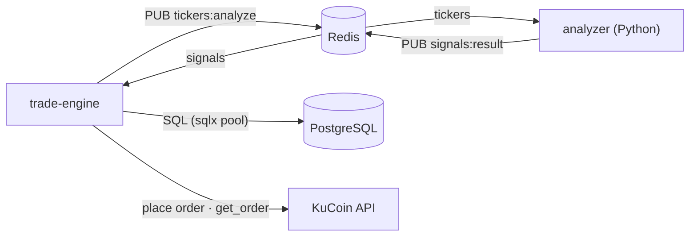
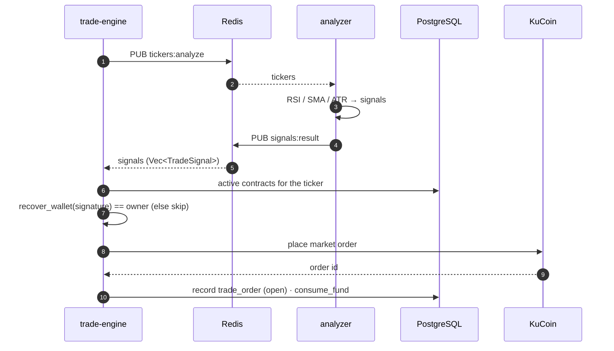
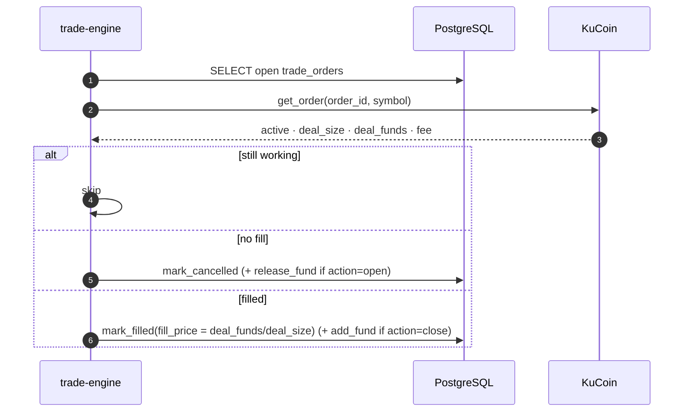

# Trade Engine

Rust process that turns **analyzer signals** into real KuCoin spot orders and keeps the
ledger in sync. It is the bridge between the Python analyzer (which only computes
signals) and the exchange, and it **re-verifies every contract before acting**
(fail-closed).

Four concurrent tasks:

- **Signal generator** — publishes the active tickers to Redis, once every 24h.
- **Signal subscriber** — consumes `signals:result` and executes per contract.
- **Contract sweeper** — every 30s, reconciles in-flight orders (by clientOid then by
  exchange id) and settles contract funds, branching on the order's `action`.
- **Order sweeper** — every 8s, exits held positions when price reaches their TP or SL.

## Connections



## Signal → execution



For each active contract on the signal's ticker:

1. Resolve the owner's wallet (`wallet_for_uid`).
2. **Verify the stored signature** — `recover_wallet(signature, message)` must equal the
   wallet, otherwise the contract is skipped (`fail-closed`).
3. Require `available_fund ≥ order_budget(init_fund)` (half the initial fund).
4. `trader::execute` — budget the order at half of `init_fund`, size `qty = budget / price`
   (floored to the pair's base increment), reserve the fund (`consume_fund`) **before**
   placing, then place a KuCoin **spot market** order and `mark_placed`. A definite
   rejection releases the reservation; an ambiguous transport error leaves the row
   `pending` for the reconciler.

## Reconciliation (sweeper)

Every **30s**, `sync_contract_status` runs two passes:

1. **Pending** — orders reserved but not yet confirmed placed (no exchange id) are looked
   up by their `clientOid`: found → `mark_placed`; absent past a grace window → `mark_failed`
   (releasing the reservation for an entry). This resolves crash/transport ambiguity.
2. **Open** — orders with an exchange id are fetched by id and settled:



Settlement is **action-aware**:

- **cancel** (finished, no fill) → `release_fund` returns the reserved funds, but only for
  an `open` **entry** (a cancelled exit reserved nothing).
- **fill** → `fill_price = deal_funds / deal_size` (VWAP). `add_fund(deal_funds)` credits
  proceeds **only for a `close` exit** — a filled entry's fund already became the held
  asset, so crediting it back would inflate the ledger.
- Amounts are parsed as `Decimal`; a malformed field aborts the settle (retried), and a
  status precondition (`open`) makes settlement idempotent.

## Order sweeper (TP/SL exit)

Every **12s**, `order_sweeper` loads held positions (`action='open'`, `status='filled'`, no
live exit), fetches the last price for each held symbol
(`GET /api/v1/market/orderbook/level1`, one light request per symbol), and for any position
whose price has reached its stored TP or SL it **reserves an exit then places a market
order** on the opposite side:

- entry `buy` → exit `sell` when `last ≥ tp` (TP) or `last ≤ sl` (SL);
- entry `sell` → inverted.

If KuCoin answers `429 Too Many Requests`, the sweep is skipped and the poll interval backs
off exponentially (30s → 300s, reset on the next successful sweep) instead of retrying on
the normal cadence.

The exit is recorded as a `close` row linked to its entry via `parent_order_id`; a partial
unique index allows only one live exit per position, and `contract_sweeper` reconciles the
fill (crediting proceeds).

## Fund accounting

Per contract, `init_fund` is the allocation; `available_fund` and `total_traded_fund`
move as orders run:

| Event                     | Effect                                                                |
| ------------------------- | --------------------------------------------------------------------- |
| entry open (on placement) | `available_fund −= trade_fund`, `total_traded_fund += trade_fund`     |
| entry fill                | no credit — the consumed fund became the held asset; `fill_price` set |
| exit (close) fill         | `available_fund += deal_funds` (proceeds returned); `fill_price` set  |
| cancel (entry)            | `available_fund += funds`, `total_traded_fund −= funds`               |

So a rounded-trip leaves `available_fund ≈ init_fund ± PnL`, and `total_traded_fund` is
the cumulative notional traded.

## Configuration

`ProcessConfig::new("trade_engine")` prefers `TRADE_ENGINE_*` and falls back to the bare
name:

| Env                                      | Purpose                                              |
| ---------------------------------------- | ---------------------------------------------------- |
| `DATABASE_URL`                           | PostgreSQL connection                                |
| `REDIS_URL`                              | Redis (pub/sub `tickers:analyze` ∕ `signals:result`) |
| `KC_KEY` / `KC_SECRET` / `KC_PASSPHRASE` | KuCoin API credentials                               |

## Layout

```
src/
  main.rs             bootstrap; spawns the sweeper, order sweeper, generator, subscriber
  app_config.rs       env config (secrets redacted in Debug)
  app_state.rs        db pool + Redis cache + KuCoin client
  signals.rs          signal_generator (tickers) + signal_handler (verify + execute)
  trader.rs           execute(): budget, reserve fund, place KuCoin spot order
  contract_sweeper.rs reconcile pending/open orders; settle contract funds (action-aware)
  order_sweeper.rs    poll prices; exit held positions on TP/SL
```

## Channel names

| Channel           | Direction         | Payload                                                                     |
| ----------------- | ----------------- | --------------------------------------------------------------------------- |
| `tickers:analyze` | engine → analyzer | `["BTC/USDT", …]`                                                           |
| `signals:result`  | analyzer → engine | `[{ ticker, action, confidence, entry_price, sl_price, tp_price, reason }]` |
