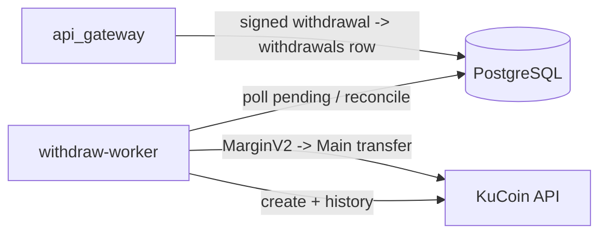

# Withdraw Worker

Rust process that executes signed USDT-ERC20 withdrawals. The API gateway verifies
the signature and queues a `pending` row; this worker re-verifies the stored intent,
moves liquidity, calls KuCoin, and settles the ledger.

- **No gRPC** — the queue is the `withdrawals` table.
- **Storage** — PostgreSQL (`withdrawals`, `ledger_entries`, `users`).
- **Exchange** — KuCoin USDT on `chain = "eth"`.

## Who talks to it, and what it talks to



The API gateway never receives exchange credentials. Only `deposit-worker`,
`trade-engine`, and `withdraw-worker` hold `KC_KEY`/`KC_SECRET`/`KC_PASSPHRASE`.

## Lifecycle

```text
pending --claim--> processing --create ok--> submitted --> completed
   |                   |                          |
   |                   +--create rejected--------> failed
   +--expires_at passed (not attempted)----------> expired
```

- `expired` / `failed` return the locked `amount + fee` to available balance.
- `completed` consumes the lock and applies the difference between the quoted and
  actual exchange fee.
- A `processing` row with `attempted_at` set is **never** expired blindly; it is
  reconciled through withdrawal history first.

## Idempotency

KuCoin withdrawals have no `clientOid`, so the worker sets:

- `remark = <withdrawal UUID>` — history echoes it back, giving an exact match for
  ambiguous create responses.
- transfer `clientOid = <withdrawal UUID>` — duplicate top-ups are rejected.

The intent (`attempted_at`, `attempted_amount`, `attempted_fee`) is persisted before
the exchange call. Status changes are conditional updates, so money is released or
settled at most once.

## Fee model

The user names the amount they receive; the fee is charged on top. The create call
uses `feeDeductType = EXTERNAL`, so the recipient receives `amount` and the fee is
billed from the Main balance. On `SUCCESS`, the worker reads the actual `fee` from
history and refunds or debits the difference.

## Environment

| Variable | Default | Meaning |
|---|---|---|
| `DATABASE_URL` | — | PostgreSQL connection string |
| `KC_KEY` / `KC_SECRET` / `KC_PASSPHRASE` | — | KuCoin API credentials (Withdrawal + General) |
| `WITHDRAW_POLL_SECS` | `15` | Loop interval |
| `WITHDRAW_CLAIM_TIMEOUT` | `120` | Seconds before an unattempted claim may expire |
| `WITHDRAW_RECONCILE_WINDOW` | `60` | Seconds before an unconfirmed create is logged for manual reconciliation |
| `WITHDRAW_MAIN_BUFFER_USDT` | `0` | Extra USDT kept in Main when topping up |

An ambiguous create is **never auto-refunded**: the worker keeps polling history
and logs an error after the window. This avoids paying twice when KuCoin is late
or the item is beyond the pages read.

## Run

```sh
cargo run -p withdraw-worker
```
