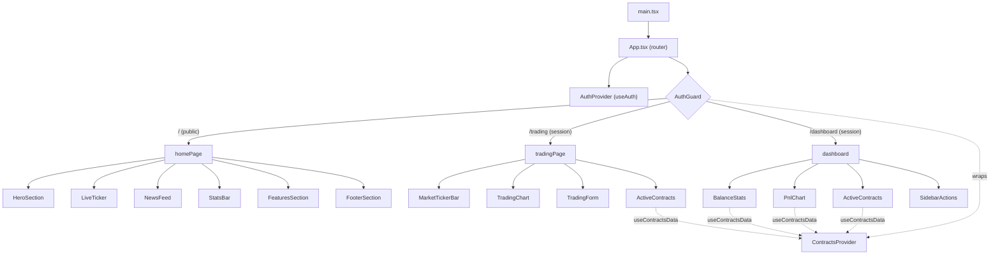
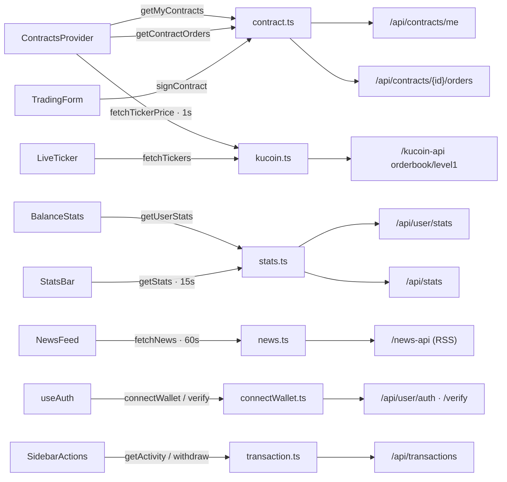

# Frontend Architecture

The React app (`react/src`) is a thin view layer over the backend REST API: providers
own auth and contract data, pages compose feature components, and `services/` wrap the
HTTP calls.

## Component tree

- **`AuthProvider`** — session state and `login`/`logout` (`useAuth`); verifies the
  session with `POST /api/user/verify`.
- **`AuthGuard`** — redirects to `/` when not authenticated.
- **`ContractsProvider`** — one fetch of contracts + orders and one 1s price sweep,
  shared by every contract/PnL consumer (see below).

## Data flow

### Runtime sequence (authenticated pages)

**On mount**

| # | Call | Result |
| --- | --- | --- |
| 1 | `POST /api/user/verify` (`useAuth`) | session → `isAuthenticated` |
| 2 | `GET /api/contracts/me` (`getMyContracts`) | the user's contracts |
| 3 | `GET /api/contracts/{id}/orders` (per contract) | each contract's orders |
| 4 | `GET /api/user/stats` (`BalanceStats`) | Total / Free / Locked balances |

**Live — every 1s** (`ContractsProvider`)

- Sweeps each distinct ticker **sequentially** → `GET /kucoin-api/api/v1/market/orderbook/level1`.
- Derives `pnlOf(order, ticker)` (filled → vs `fill_price`; open → vs `funds / requested_qty`),
  `contractPnl`, and `totalPnl`; re-renders consumers on each tick.

**Landing pollers**

| Component | Endpoint | Interval |
| --- | --- | --- |
| `StatsBar` | `GET /api/stats` | 15s |
| `NewsFeed` | `GET /news-api/rss` | 60s |
| `LiveTicker` | `GET /kucoin-api/.../allTickers` | 10s |

## Components → data source

| Component         | Data source                                 | Notes                             |
| ----------------- | ------------------------------------------- | --------------------------------- |
| `HeroSection`     | `useAuth`, `LiveTicker`                     | login + wallet                    |
| `LiveTicker`      | `services/kucoin` · `/kucoin-api`           | BTC/ETH/SOL prices                |
| `NewsFeed`        | `services/news` · `/news-api`               | CoinTelegraph RSS                 |
| `StatsBar`        | `services/stats` · `/api/stats`             | public aggregates                 |
| `ActiveContracts` | `useContractsData`                          | list + detail + orders + live PnL |
| `PnlChart`        | `useContractsData`                          | cumulative PnL series             |
| `BalanceStats`    | `services/stats` + `useContractsData`       | balances + total PnL              |
| `TradingForm`     | `services/contract`, `services/transaction` | sign contract                     |
| `SidebarActions`  | `services/transaction`                      | deposits / activity               |

## Providers & hooks

| Hook / provider    | File                            | Responsibility                                                                                  |
| ------------------ | ------------------------------- | ----------------------------------------------------------------------------------------------- |
| `useAuth`          | `hooks/useAuth.tsx`             | session state, `login`, `logout`                                                                |
| `useContractsData` | `hooks/useContractsData.tsx`    | contracts, orders, prices, `pnlOf` / `contractPnl` / `totalPnl`; effects key on the contract-id set |
| `useTheme`         | `hooks/useTheme.tsx`            | light / dark                                                                                    |

## Cross-cutting behavior

- **Session expiry** — a global axios `401` response interceptor (`main.tsx`) bounces
  `/dashboard` and `/trading` back to `/`; `AuthGuard` also redirects unauthenticated routes.
- **Refresh on change** — after signing a contract or a completed deposit the app dispatches
  a `contracts:changed` window event; `useContractsData`, `BalanceStats`, and
  `SidebarActions` listen and refetch. Balances are also refreshed after deposit/withdraw.
- **Money** — the API returns amounts as decimal **strings**, already in human units; format
  them as-is (no `÷ 1e6` scaling).
- **Withdraw (pending)** — the UI exposes "Withdraw Assets" but the endpoint is not
  implemented yet (`POST /api/transactions/withdraw` → 404).
